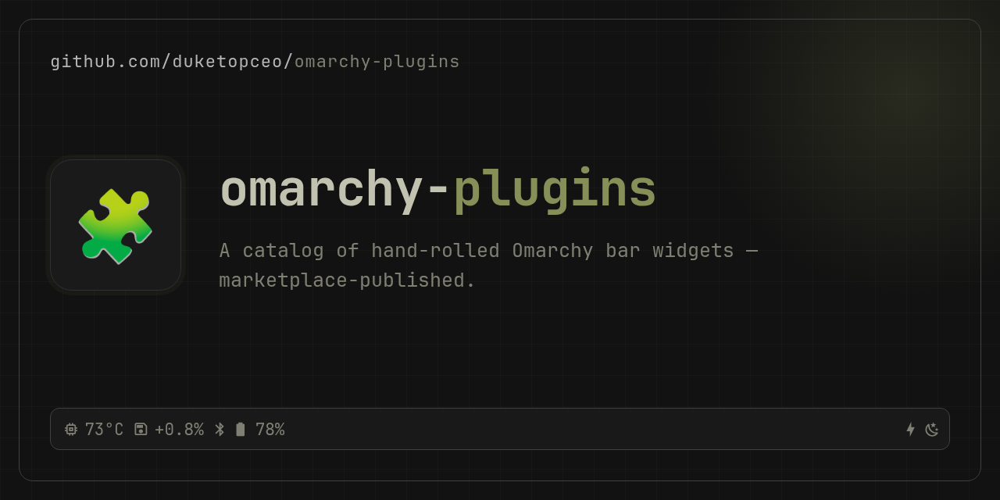

# omarchy-plugins

<p align="center">
  <picture>
    <source media="(prefers-color-scheme: dark)" srcset="assets/brand/wordmark-dark.svg">
    
  </picture>
</p>

<p align="center">
  
</p>

> Luke's personal Omarchy bar plugins plus a laptop restore index. Not first-party Omarchy, and not a marketplace listing.

## Stack

- Quickshell / QML (Omarchy shell plugins)
- Python 3 helpers (hardware and power stats, weather, supply-chain and agent-activity scans, Perplexity search)
- Bash installer

## Local Setup

```bash
git clone https://github.com/duketopceo/omarchy-plugins
cd omarchy-plugins

uv run --with pytest pytest -q
python scripts/validate-manifests.py

# live install (hot-reload from this tree)
./scripts/install.sh --link

# release-style copy with generated artifacts excluded and validated
./scripts/install.sh --copy

# read-only live inventory (JSON by default; markdown with --format markdown)
python3 scripts/audit-live-plugins.py --no-git
```

The inventory distinguishes configured, direct-bar, tray-hosted, disabled, and
runtime-observed states without writing shell configuration or exposing secret
values. Live runs probe a fixed allowlist of user and system service units; use
`--fixture-root` for a host-independent audit. Legacy installer backups move
outside the discovery root and remain available for rollback. No `.env`
required. See `.env.example`.

## Plugins

| Id | What |
|---|---|
| `lukedaduke.fan` | RAM, CPU/GPU/NVMe temps, top processes, fan presets + custom curves |
| `lukedaduke.standby` | OLED nightstand overlay: clock, weather, markets, red tint, caffeine |
| `lukedaduke.nexus` | Hardware topology radar: USB/BT/NVMe interconnect map |
| `lukedaduke.power` | Battery status, charge graph, top consumers, power profiles |
| `io.github.duketopceo.bumblebee` | Supply-chain exposure radar: packages and dev tools checked against a known-compromise catalog |
| `io.github.duketopceo.numbat` | AI-agent activity radar: live agent list and findings from Perplexity's numbat monitor |
| `io.github.duketopceo.pplx` | Quick-ask UI for the Perplexity Search API (`pplx` CLI, bring your own key) |
| `io.github.duketopceo.neo` | BrowserOS neo sidecar status and control: unit health, ports, MCP endpoint |

### Retired

`lukedaduke.connections`, `lukedaduke.ticker` and `lukedaduke.agents` are retired in favour of
Omarchy's built-in `omarchy.bluetooth` / `omarchy.network`, `mohamedmansour.finance`, and
`akitaonrails.ai-usagebar`. Their folders hold a final notice-only stub release.

## Deploy / visibility

This umbrella repo is **public**: https://github.com/duketopceo/omarchy-plugins

Each plugin is also published as its own installable repo (`manifest.json` at root, `omarchy plugin validate` clean):

| Plugin | Repo |
|---|---|
| `lukedaduke.fan` | https://github.com/duketopceo/omarchy-fan |
| `lukedaduke.standby` | https://github.com/duketopceo/omarchy-standby |
| `lukedaduke.nexus` | https://github.com/duketopceo/omarchy-nexus |
| `lukedaduke.power` | https://github.com/duketopceo/omarchy-power |
| `io.github.duketopceo.bumblebee` | https://github.com/duketopceo/omarchy-bumblebee |
| `io.github.duketopceo.numbat` | https://github.com/duketopceo/omarchy-numbat |
| `io.github.duketopceo.pplx` | https://github.com/duketopceo/omarchy-pplx |
| `io.github.duketopceo.neo` | https://github.com/duketopceo/omarchy-neo |

Install any of them with:

```bash
omarchy plugin add https://github.com/duketopceo/omarchy-fan
```

To list on the marketplace, submit the per-plugin repo at [plugins.omarchy.org/publish](https://plugins.omarchy.org/publish.html).

This umbrella stays the authoring catalog — edit here, then `git subtree push --prefix=plugins/<id> <repo> main` to ship an update. Or install locally with `scripts/install.sh`.

See [docs/UPSTREAM.md](docs/UPSTREAM.md).

## Docs

- Design direction for every plugin (Pilot Light): [`DESIGN.md`](DESIGN.md); roadmap: [`ROADMAP.md`](ROADMAP.md); landscape: [`docs/research/2026-10-11-landscape.md`](docs/research/2026-10-11-landscape.md)

- Plugin trust/reliability rules: [`docs/PLUGIN_CONTRACT.md`](docs/PLUGIN_CONTRACT.md)
- Active inventory review: [`docs/reviews/active-plugin-estate.md`](docs/reviews/active-plugin-estate.md)
- Deep runtime/source audit: [`docs/reviews/active-plugin-deep-audit.md`](docs/reviews/active-plugin-deep-audit.md)
- Host integration health: [`docs/HOST_INTEGRATION.md`](docs/HOST_INTEGRATION.md)
- Secret/data lifecycle: [`docs/DATA-LIFECYCLE.md`](docs/DATA-LIFECYCLE.md)
- Surface migration dry-run: [`docs/SURFACE-MIGRATION.md`](docs/SURFACE-MIGRATION.md)
- Release/publish workflow: [`docs/UPSTREAM.md`](docs/UPSTREAM.md)
- See `AGENTS.md` for agent context.
- Plan: `docs/plans/2026-09-02-001-feat-omarchy-plugins-marketplace-plan.md`
- New laptop restore: [`machine/INDEX.md`](machine/INDEX.md) and [`machine/RESTORE.md`](machine/RESTORE.md) (no secrets; private configs live in `duketopceo/dotfiles`)
