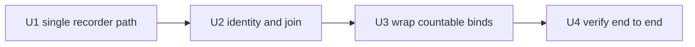

# Hotkey Tally Binding Wrapping - Plan

## Goal Capsule

- **Objective:** The Keybindings menu shows how often each personal key is actually used, so key decisions stop resting on guesswork.
- **Means:** Route countable personal binds through one record-then-run helper, and read counts back into the existing menu (KTD1, KTD2).
- **Authority:** Product Contract wins on behavior; KTDs win on mechanism within it; no unit overrides either.
- **Execution profile:** Local machine configuration. Stash-first edits, reload, verify. No build, no deploy, no network.
- **Stop conditions:** A wrapped bind stops running its command, or fires twice, or `hyprctl configerrors` reports an error after reload. Revert from the stash and stop.
- **Finishes the work:** The implementer lands U1-U4 on this machine and leaves the plan's Verification Contract green.

Paths inside `omarchy-plugins` are repo-relative. Hyprland and user config live outside the repo, so those paths appear home-relative (`~/.config/hypr/bindings.lua`) and are exempt from the repo-relative rule.

---

## Product Contract

### Summary

Wire the personal Hyprland binds so each press records one activation, then let the existing Keybindings menu render those counts next to the key they belong to. Only binds that can be counted honestly are wrapped.

### Problem Frame

The tally plugin, the record store, and the menu annotation all exist. Every row still reads zero, because no binding reports anything. A usage list that is always zero tells the operator nothing, which is the opposite of what it was built for.

Research found a second problem underneath the first. Counts are keyed on the action label alone, and labels repeat: `BrowserOS` twice, `Screenshot region` on both F10 and SUPER+F10, and `Apps menu` on F3, F4, and a stock `SUPER+ALT+SPACE` bind. Wrapping as things stand would merge three different keys into one number and present a count against the wrong key.

A third problem is deployment, not logic. Three components disagree about where the recorder lives: the Lua helper points at a file that has never existed, the menu fork points into the plugin repo, and the bar widget points at the installed plugin. Any wrap written today records nothing, silently, because the failure is redirected to `/dev/null`.

### Requirements

- R1. Each wrapped binding records exactly one activation per physical press.
- R2. A wrapped binding runs the same command it ran before; if recording fails, the command still runs.
- R3. A count renders against the specific key-and-action row that produced it, never against a shared label bucket.
- R4. Binds that cannot be counted honestly stay unwrapped: hardware switch events, key-release halves, auto-repeating keys, and both menu openers.
- R5. A wrapped bind that has never been pressed must be distinguishable from an unwrapped bind, so a blank count is never read as a measurement.
- R6. A missing helper or recorder must not stop Hyprland from loading the rest of the configuration.
- R7. Binds are edited in the machine stash first, then copied live, and the reload reports no configuration errors.
- R8. The usage-ordered view is reachable from its own key and lists measured keys ahead of unmeasured ones.

### Key Decisions

- **Keep the stock Keybindings picker and annotate it, rather than shipping a second list.** (session-settled: user-directed — chosen over a standalone TUI list: the operator wants the tool they already use.) Governs R3.
- **Sort-by-usage lives on its own key (SUPER+SHIFT+K) instead of a toggle inside the menu.** (session-settled: user-directed — chosen over an in-menu toggle: the stock picker cannot host one without forking its keyboard handling.) Governs R8.

### Scope Boundaries

- Stock Omarchy binds under `/usr/share/omarchy` are not wrapped. Counting them means shadowing each one explicitly, which is separate work.
- No keystroke capture, no window or title attribution, no network transmission. The stored row stays `{id, key, label, ts}`.
- No bar-widget work. `Panel.qml` stays as it is; the menu is the surface this plan serves.

#### Deferred to Follow-Up Work

- Shadowing stock binds one at a time, starting with the highest-value ones.
- Registering the plugin in `shell.json` so the bar widget is live.

### Success Criteria

- After one press of a wrapped key, that key's row shows `×1` in the picker, and a second press shows `×2`.
- No two distinct keys share a counter.
- `hyprctl configerrors` is empty after the reload.

---

## Planning Contract

### Key Technical Decisions

- **KTD1. One canonical recorder path, `~/.local/bin/hotkey-tally`, plus one installed helper at `~/.config/hypr/hotkey-tally.lua`, both referenced absolutely.** Three paths exist today and none of them resolve for the Lua helper, so the first unit is deployment, not wrapping. An absolute path is required because compositor-spawned execs resolve `/usr/share/omarchy/bin` ahead of the user path, and a repo path would break on a branch switch while `pcall` swallowed the error.
- **KTD2. Identity is a hash of the normalized key plus the label, and the menu joins on the same pair.** Five personal labels repeat (BrowserOS, Apps menu, and the three Screenshot variants), and three of them also appear on stock rows — `Apps menu` on F3, F4, and `SUPER+ALT+SPACE`. Label-only identity would merge distinct keys into one counter and render that number against the wrong row. The canonical key text is what the picker displays, so the recorder resolves XF86 symbols through the same F-row map the menu applies (`XF86LaunchA` to `F3`, `XF86AudioMute` to `F10`) before hashing. Without that, the F-row binds record under a key name no menu row carries and stay permanently invisible. The recorder exposes one counts feed so the menu fork does not re-implement the join.
- **KTD3. The helper loads through `pcall(dofile, …)`.** A bare `dofile` of a missing file aborts `hyprland.lua` at the bindings line, taking look-and-feel, autostart, and window rules down with it. R6 exists because that failure mode is silent until the next login.
- **KTD4. The recorder runs detached, after the action is launched.** A cold `python3` start measured at roughly 28 ms per press, and it sat in front of push-to-talk capture. Detaching keeps R2's guarantee while removing the latency.
- **KTD5. Skip the four uncountable classes rather than approximating them.** A release-half bind records twice per hold; an auto-repeating brightness key spawns a recorder per key-repeat tick; a switch event has no label at all and collapses into one shared bucket; the menu opener would inflate itself, because the menu caches the wrapped command and dispatches it on selection.

### Implementation Constraints

- `~/.local/share/machine/lukekimball/bindings.lua` is the canonical copy. `sync-watch` reverts the live file from it, so a live-only edit disappears on the next sync.
- `o.bind` turns a string into `hl.dsp.exec_cmd`, so a shell prefix is safe on any string target. `{launch = …}` becomes `uwsm-app -- …`.
- After any Hyprland edit: reload, then read `hyprctl configerrors` before judging the change.

### Assumptions

- `python3` remains on `PATH` for the recorder; it is already a dependency of the plugin.
- A count is lifetime cumulative for the wrapped bind, not windowed. The store's prune step stays manual, so a number never decreases on its own; a windowed view is follow-up work.
- Menu dispatch of a wrapped bind counts as a use. That is defensible — it is a deliberate activation — and is not separately gated.

### Sequencing

U1 makes recording possible at all. U2 makes the counts land on the right row. U3 wraps the binds. U4 proves the chain. U3 without U1 records nothing; U3 without U2 produces wrong numbers.

---

## Implementation Units

### U1. Single recorder path

- **Goal:** The in-scope consumers (the Lua helper and the menu fork) resolve one recorder, and a missing one is visible instead of silent.
- **Requirements:** R1
- **Dependencies:** none
- **Files:** `plugins/io.github.duketopceo.hotkey-tally/hotkey-tally.lua`, `~/.local/bin/hotkey-tally` (new wrapper), `~/.config/hypr/hotkey-tally.lua` (installed helper copy), `~/.local/bin/omarchy-menu-keybindings` (fork), `~/.local/share/machine/lukekimball/` (fork backup), `README.md`
- **Approach:**
  - Install the CLI at `~/.local/bin/hotkey-tally` so the in-scope consumers share one absolute path.
  - Point the Lua helper at that path and drop the nonexistent state-directory path.
  - Copy the helper to `~/.config/hypr/hotkey-tally.lua` rather than dofile-ing the repo copy, so a branch switch cannot empty the counts.
  - Drop the `2>/dev/null` on the record step and write one `last-error` line into the state directory instead, so a moved recorder is visible.
  - Keep a copy of the menu fork in the machine stash beside `bindings.lua`, because an `omarchy update` or a rebuild otherwise reverts the picker to the stock copy with no error.
  - Correct the README's claim that SUPER+K opens the tally: it opens the annotated picker, and the usage-ordered view is SUPER+SHIFT+K.
- **Patterns to follow:** the existing user-bin launchers (`~/.local/bin/omarchy-menu-keybindings`, `~/.local/bin/browseros`), which are absolute-path targets for compositor execs.
- **Test scenarios:**
  - Running the installed path with `list` exits zero and prints an empty list on a clean state directory.
  - Removing the state directory and running `record` recreates it and appends one row.
  - Moving the recorder away leaves `last-error` written, rather than a silent no-op.
  - The plugin's pytest suite still passes after the helper path changes.
- **Verification:** `~/.local/bin/hotkey-tally` is executable, `~/.config/hypr/hotkey-tally.lua` exists, and a manual `record` followed by `list` shows one row.

### U2. Identity and menu join

- **Goal:** A count belongs to one key and one action, and the menu attaches it to that row.
- **Requirements:** R3
- **Dependencies:** U1
- **Files:** `plugins/io.github.duketopceo.hotkey-tally/bin/hotkey-tally.py`, `plugins/io.github.duketopceo.hotkey-tally/hotkey-tally.lua`, `plugins/io.github.duketopceo.hotkey-tally/tests/test_hotkey_tally.py`, `~/.local/bin/omarchy-menu-keybindings` (local fork, outside the repo)
- **Approach:**
  - Derive the id from normalized key plus label, so F3 and F4 stop sharing "Apps menu".
  - Normalize once, in the recorder, and expose a counts feed keyed by that pair; the menu fork consumes the feed instead of rebuilding the hash.
  - Keep the stored row schema unchanged.
- **Patterns to follow:** the fork's existing `annotate_hotkey_counts` reads a label-keyed map; the join narrows to a pair without changing how the menu renders.
- **Test scenarios:**
  - Two rows with the same label and different keys keep separate counts.
  - Two rows with the same key and label still merge, as intended for genuine duplicates.
  - Normalizing `SUPER + SHIFT + F` and the menu's `SUPER SHIFT + F` yields the same id.
  - A bind declared as `SUPER + XF86AudioMute` and the menu row shown as `SUPER + F10` produce the same id.
- A row recorded before the change still counts after it, or is reported as unmatched rather than silently dropping.
- **Verification:** the test suite covers the collision pair, and a manual record against a duplicated label shows one row changing.

### U3. Wrap the countable binds

- **Goal:** Personal binds record on use, with uncountable ones left alone.
- **Requirements:** R1, R2, R4, R6, R7
- **Dependencies:** U1, U2
- **Files:** `~/.local/share/machine/lukekimball/bindings.lua` (stash, edit first), `~/.config/hypr/bindings.lua` (copy), `plugins/io.github.duketopceo.hotkey-tally/hotkey-tally.lua`
- **Approach:**
  - Load the helper through the guarded `pcall` form at the top of the file.
  - Convert binds one class at a time: launch-table targets, plain command strings, then shell blocks. Each keeps its existing `hl.unbind` shadowing line.
  - Leave unwrapped: the two `switch:` lid binds, the `release` half of push-to-talk, the repeating brightness binds, and both menu-opening binds.
  - Mark the wrapped set in the picker, so a wrapped bind with no presses shows a zero and an unwrapped bind shows no count at all (R5).
  - Copy the stash to the live path, reload, and read configuration errors before moving on.
- **Execution note:** This is configuration work; prefer a reload plus one live press over unit coverage, and stop at the first bind whose command no longer behaves as before.
- **Patterns to follow:** the file's existing per-bind comment convention, which states what a bind replaced.
- **Test scenarios:**
  - A wrapped bind still launches its application, and one row appears in the store.
  - A wrapped bind whose recorder is temporarily unavailable still launches its application.
  - The unwrapped classes produce no rows.
  - `hyprctl configerrors` reports nothing after the reload.
- **Verification:** every countable personal bind is wrapped, the four excluded classes are visibly untouched, and the file loads clean.

### U4. Prove the chain

- **Goal:** Counts appear in the picker from a real activation, and the rollback is known.
- **Requirements:** R1, R3, R5, R6
- **Dependencies:** U3
- **Files:** `~/.local/share/machine/lukekimball/bindings.lua`, `plugins/io.github.duketopceo.hotkey-tally/README.md`
- **Approach:**
  - Clear the store first, so the assertion is about this press rather than earlier verification rows.
  - Activate one wrapped bind twice and confirm two new rows appear.
  - Open the picker and confirm the count renders against that key and action, not against a sibling with the same label.
  - Confirm the usage-sorted variant orders that key first.
  - State the rollback in the README: restore the stash copy, reload, confirm clean.
- **Test scenarios:**
  - Two presses yield `×2` on exactly one row.
  - A second key with a previously colliding label gains no rows.
  - An unwrapped bind renders no count, while a wrapped bind with no presses renders a zero.
  - The usage-sorted menu lists the pressed key ahead of unused ones.
- **Verification:** the picker shows a non-zero count from a real press, and no other row moved.

---

## Verification Contract

| Check | Command | Applies to |
|---|---|---|
| Config loads | `hyprctl reload` then `hyprctl configerrors` (empty output) | U3, U4 |
| Recorder works | `hotkey-tally record --key "SUPER + T" --label "Terminal"` then `hotkey-tally list` | U1, U2 |
| Counts reach the menu | `~/.local/bin/omarchy-menu-keybindings --print` shows the count on the expected row | U2, U4 |
| Zero is distinguishable | an unwrapped row renders no count; a wrapped, unpressed row renders a zero | U2, U4 |
| Plugin tests | `uv run --with pytest python -m pytest tests/` in the plugin directory | U1, U2 |
| Live activation | one press of the chosen wrapped bind, then `hotkey-tally list` | U4 |

---

## Definition of Done

- Every countable personal bind records one row per press; the four excluded classes record none.
- No two distinct keys share a counter, proven against the `Apps menu` and `Screenshot` collisions.
- The picker shows a non-zero count from a real press, on the right row.
- `hyprctl configerrors` is empty after the final reload.
- The plugin test suite passes.
- A missing helper or recorder cannot break configuration loading.
- No abandoned experiments remain in the diff or the stash.
