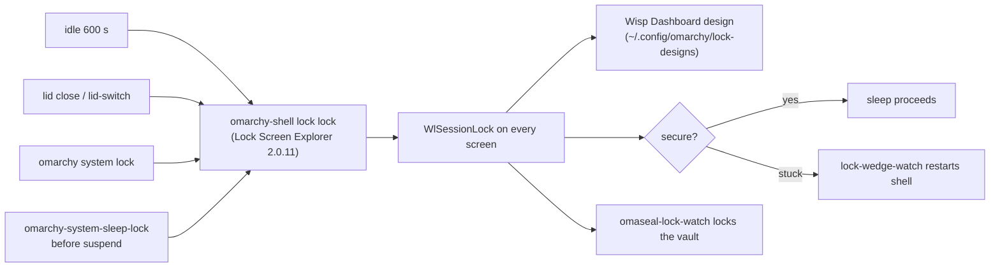

# Lock Screen Upgrade and Omarchy Estate Cleanup - Plan

**Target:** this repo (`omarchy-plugins`) plus machine configuration on `omarchy-max`. Paths starting with `~/` are machine files outside the repo; everything else is repo-relative.

---

## Goal Capsule

- **Objective:** the owner's laptop locks reliably with a rich, good-looking lock screen, and its Omarchy setup has no stale docs, dead config, unused plugins or known breakage left unexplained.
- **Means:** upgrade Lock Screen Explorer and add one custom design kept in this repo (KTD1); apply audit fixes in safe-first order, with every non-trivial removal or system change confirmed by the owner (KTD4).
- **Authority:** owner decisions in this plan's Key Decisions > research dossiers > existing machine docs. `~/.claude/CLAUDE.md` and `~/AGENTS.md` are known to be stale and are corrected by U5, not trusted.
- **Stop conditions:** stop and ask before any step that could leave the machine without a working lock screen; before any `sudo`, PAM, kernel-module or logind change; before removing any plugin or binary the owner has not approved.
- **Execution profile:** interactive, owner present at the laptop (lock tests need a human to type the password).
- **Who finishes:** the agent prepares and applies approved changes; the owner runs the physical lock, lid and suspend checks.

---

## Product Contract

### Summary

Keep Lock Screen Explorer as the lock engine, upgrade it from 1.9.6 to 2.0.11, and add one rich custom design ("Wisp Dashboard") that lives in this repo. Then clean up the Omarchy estate: update outdated plugins, remove unused ones, delete dead config, fix stale machine docs, add a guard against the sudo-loop lockout, and restore the Asahi kernel patches lost in the last kernel upgrade.

### Problem Frame

The owner dislikes the current lock screen. Last night a forgotten `yay --sudoloop` tripped faillock for about five hours, and faillock is shared with the lock screen, so the laptop could have refused its own password. An audit (2026-11-01) found the machine docs out of date on lid behavior, kernel version, local inference and units. It also found six third-party plugins behind upstream, several unused or retired plugins, dead Hyprland files and two failed units. Most seriously, the Oct 28 kernel upgrade silently replaced the patched `phy-apple-atc.ko` and `typec.ko`: the dead-USB-C-port bug (`Pipehandler lock not acked`) is back, 51 times this boot, while the docs say "CONFIRMED live".

### Key Decisions

- **Upgrade Lock Screen Explorer and add a custom design instead of building a new lock plugin.** (session-settled: user-directed — chosen over a new `lukedaduke.lock` built from Explorer's code or from the stock lock: Explorer 2.0.11 already handles wake, resume, multi-monitor and keep-display-on, and is the only maintained Omarchy lock with real adoption.) Governs R1, R2.
- **One rich layout, not several.** (session-settled: user-directed — chosen over switchable designs: less to build and maintain.) Governs R3.
- **Wisp appears as decoration only.** (session-settled: user-directed — chosen over a usable Wisp control or none: a fun touch that does nothing while locked.) Governs R4.
- **Audit fixes are listed with only doc corrections and dead-file removals applied automatically; everything else waits for the owner's OK.** (session-settled: user-approved — the agent proposed the split, the owner confirmed scope.) Governs R7–R12.

### Requirements

**Lock screen**

- R1. Lock Screen Explorer runs 2.0.11, with the owner's local edits to it preserved or deliberately dropped, the `keepDisplayOn` setting kept, and a lost lock surface never treated as an unlock.
- R2. Locking keeps working through every path that triggers it: idle timeout, lid close, `omarchy system lock`, and suspend; the sleep monitor still sees a secure lock before sleep.
- R3. One custom design shows clock and date, weather, now-playing, battery and system state, and a count of new notifications (count only, never notification text), in the current Omarchy theme's colors.
- R4. The design includes a small animated Wisp orb that reads no data and accepts no input.
- R5. The design's source lives in this repo and survives Explorer updates.
- R6. The machine is never left without a working lock screen during the change, and there is a known way back.

**Plugins**

- R7. Third-party plugins behind upstream are updated: ai-usagebar, calendar, hyprmoncfg, omaphones, omaplug (lock-explorer is R1).
- R8. Plugins the owner approves for removal are removed cleanly, with no dangling references in `shell.json`.
- R9. omasettings, which its author has superseded, is replaced by OmaControl or removed, per the owner.

**Config, docs and safety**

- R10. Dead config files and backup clutter are removed; failed units are fixed or disabled with a reason.
- R11. `~/.claude/CLAUDE.md`, `~/AGENTS.md` and the stash copy describe the machine as it is, and say the same thing.
- R12. A `sudo` keep-alive loop without a terminal can no longer lock the owner out for hours.
- R13. The patched `phy-apple-atc.ko` and `typec.ko` are rebuilt for the running kernel, `usb-port-rescue` is working again, and a future kernel upgrade that drops them is noticed.

### Success Criteria

- The owner locks, closes the lid on battery, suspends, wakes and unlocks with the new design, and nothing logs "suspending without a secure lock".
- `Pipehandler lock not acked` stops appearing after a reboot onto the rebuilt modules.
- A fresh agent reading CLAUDE.md finds no claim the audit marked stale.

### Scope Boundaries

- Not porting Omarchy 4.5. The mac fork has no 4.5 yet, and upstream 4.5 is rc2 and says it merges Omarchy Mac into Omarchy. Its lock changes are tracked in Deferred.
- No fingerprint, Touch ID or face unlock (no Asahi driver). FIDO2 stays as Explorer provides it, unconfigured.
- No new plugins are installed by this plan, except OmaControl if the owner picks it to replace omasettings (R9); the survey's other candidates go to the owner as a list (Deferred).
- Considered and not built: a separate faillock tally for the lock screen. It needs PAM edits on both `system-auth` and `omarchy-lock-password`; the yay guard (U6) removes the cause seen here. Revisit if another process loops on sudo.

### Deferred to Follow-Up Work

- Adopt Omarchy 4.5 lock changes when the mac fork reaches 4.5: video wallpaper still frames, key-repeat limited to Backspace/Delete, wallpaper pre-decode on wake. Re-check whether Explorer still needs the `authentication` capability under 4.5's plugin restrictions.
- Re-try the built-in clock and tray on 4.5 (Elsewhen world clock, stock tray drawer).
- Plugin additions from the survey for the owner to pick: omdrop (AirDrop), omastats (system monitor), omarchy-agent-bar, syncshell.
- Sync the owner's audio-control fork with upstream 0.9.1.
- Fix the shell's 495 `QQmlVMEMetaObject` warnings once the plugin causing them is found.

---

## Planning Contract

### Key Technical Decisions

- KTD1. The custom design is a standalone `.qml` in this repo, installed into `~/.config/omarchy/lock-designs/` by link, built on Explorer's `DesignBase` and its `designs/Live*.qml` widgets. Explorer loads custom designs from that folder and keeps them across updates, so no fork is needed. Instantiates R3, R5 (session-settled: user-directed — inherits the upgrade-Explorer decision).
- KTD2. The Wisp orb is pure QML animation with no file reads. Wisp's state file (`$XDG_RUNTIME_DIR/wisp/state.json`) carries spoken transcripts, so reading it on a lock screen would leak them. The animation pauses while the display is off. Governs R4.
- KTD3. The notification count comes from counting notification-history files newer than the lock time by file name only. The Omarchy shell exposes no count to plugins, and showing text would leak content on the lock screen. Governs R3.
- KTD4. Order of work: safe and reversible first (docs, dead files), then the lock upgrade with a rollback ready, then plugin changes, then system changes needing `sudo` last. A broken lock is the worst failure, so it gets its own step with the escape route tested first.
- KTD5. The sudo-loop guard is a `yay` wrapper earlier on `PATH` that refuses `--sudoloop` when there is no terminal. It is the smallest fix for the cause actually seen. A watchdog that kills sudo loops is considered and not built: it is broader and could kill legitimate work.
- KTD6. Kernel modules are rebuilt with the existing procedure and patches in `~/.local/share/kernel-patches/`, ported to the running `7.2.12-3` tree, installed beside fresh `.orig` copies. A `pacman` hook that warns when a kernel upgrade replaces them is how the next upgrade gets noticed.

### High-Level Technical Design

How a lock happens after the change. Explorer owns the `lock` IPC target, so every trigger reaches the same service.

### Sequencing

U5 and U4 (docs, dead files) → U1 (Explorer upgrade, with rollback tested) → U2 (design) → U3 (plugins) → U6 (yay guard) → U7 (kernel modules, owner present, reboot).

### Assumptions

- Explorer 2.0.11 still reads `keepDisplayOn` from its `shell.json` entry and still loads `~/.config/omarchy/lock-designs/` (true in 1.9.6; re-check its changelog during U1).
- The owner can reach the laptop from a second device over SSH (Tailscale) or a TTY. `loginctl unlock-session` is not assumed to work: neither Explorer nor the stock lock listens for logind's unlock signal, so U1 tests and records a real escape route first.

---

## Implementation Units

### U1. Upgrade Lock Screen Explorer to 2.0.11

**Goal:** Explorer is on 2.0.11 with no loss of the owner's settings or edits.
**Requirements:** R1, R2, R6.
**Dependencies:** none.
**Files:** `~/.config/omarchy/plugins/io.github.sirjul1337.lock-explorer/` (git checkout), `~/.config/omarchy/shell.json`, `~/.config/omarchy/lock-explorer.json`, `machine/lock-explorer-local.patch` (new, saves local edits), `~/bin/display-rescue` (still calls `loginctl unlock-sessions`).
**Approach:**
1. Save the checkout's full local diff (93 files) into this repo as two patches: the one-line `import QtQuick 6.11` change across 92 files, and the `Service.qml` hardening that re-acquires a lost session lock instead of treating the loss as an unlock. Show the owner both.
2. Find a working escape route on the current 1.9.6 before touching anything: from SSH or a TTY, lock with `omarchy-shell lock lock`, then try restarting the shell and check whether Hyprland lets the new locker take over (`misc:allow_session_lock_restore`). Record the route that works in this unit and in the docs; fix `~/bin/display-rescue` to use it.
3. Clean the checkout (the update only fast-forwards a clean tree), then update with `omarchy plugin update io.github.sirjul1337.lock-explorer` and restart the shell (the lock service only reloads on restart).
4. Re-port the hardening to 2.0.11, whose `Service.qml` still releases on surface loss; its context lines moved, so expect a manual port. Re-apply the import change only if 2.0.11 still needs it.
5. Check that `keepDisplayOn` and the design choice survived in `shell.json` and `lock-explorer.json`.
**Patterns to follow:** Explorer README "Install details" (service handover takes a few seconds; restart the shell if `lock explore` says `Function not found`).
**Test scenarios:**
- `omarchy-shell lock status` returns JSON with `locked`, `secure`, `sessionLocked`, `requested`, `pending`, `authenticating` (the keys `lock-wedge-watch` reads).
- `omarchy-shell lock preview` shows the current design without locking; `hidePreview` closes it.
- Real lock, then unlock with the correct password: the session returns.
- Real lock, wrong password once: a failure message appears and the next correct password unlocks.
- Lock with the external monitor attached: every screen is covered.
- Lock, then make the lock surface go away (unplug the external monitor, or suspend and resume): the session stays locked and the log shows the lock being re-acquired.
- With the screen locked, the recorded escape route returns a usable session from SSH or a TTY.
**Verification:** the owner locks and unlocks, and `journalctl` shows no lock errors from the shell.

### U2. Wisp Dashboard lock design

**Goal:** one rich lock design, kept in this repo, active on the laptop.
**Requirements:** R3, R4, R5; KTD1, KTD2, KTD3.
**Dependencies:** U1.
**Files:** `lock-designs/WispDashboard.qml` (new), `lock-designs/README.md` (new), `scripts/install-lock-design.sh` (new, links the design into `~/.config/omarchy/lock-designs/`), `tests/test_lock_design.py` (new).
**Approach:**
1. Start from Explorer's blank design (`extras/lock-designs/MyDesign.qml`) and keep its required import line.
2. Compose Explorer's live widgets for weather, music and system, plus clock, date, the password field and a notification-count badge (KTD3).
3. Add the Wisp orb as a self-contained animated item (KTD2).
4. Take every color from the Omarchy theme, as this repo's AGENTS.md requires.
5. Install by link, then `omarchy-shell lock rescanDesigns`, select it, and preview.
**Patterns to follow:** Explorer's `designs/Live*.qml` widgets and `DesignBase` properties (README "Your own designs"); this repo's theme rule (`qs.Commons` Color/Style only).
**Test scenarios:**
- The design file passes `qmllint` with Explorer's design folder on the import path.
- No hardcoded hex colors appear in the file (repo convention check).
- No path to Wisp's state file, and no notification body text, appears in the file.
- Preview with music playing shows the track; preview with no player hides the music row instead of showing an empty box.
- Preview offline: weather shows a quiet placeholder, not an error.
- Preview after a wrong password (`previewFail`): the failure state is readable over the design.
- Switching the Omarchy theme changes the design's colors on the next preview.
**Verification:** the owner previews and then really locks with the design and likes it.

### U3. Plugin estate: update, replace, remove

**Goal:** every installed plugin is current, used, or gone.
**Requirements:** R7, R8, R9.
**Dependencies:** U1.
**Files:** `~/.config/omarchy/plugins/*`, `~/.config/omarchy/shell.json`, `catalog.json` (if a repo plugin is retired), `machine/` inventory.
**Approach:**
1. With the owner's OK, update: ai-usagebar 1.32.0 → 1.47.0, calendar 0.7.0 → 0.9.2, hyprmoncfg 2.7.0 → 2.11.0 (keep `hyprmoncfgd` unmanaged), omaphones 1.3.13 → 1.3.18, omaplug 1.6.6 → 1.7.0. One at a time; check the bar after each.
2. Show the owner the removal list and remove only what they approve: the retired stubs (lukedaduke.agents, connections, ticker), gemini-bar, io.github.duketopceo.neo, jankeesvw.notification-center, nixfred.blip, localdev.secrets.
3. Fix jankeesvw.herdr: enable it or drop it from `shell.json` `plugins` and the tray widget list.
4. omasettings: replace with OmaControl or remove, per the owner.
**Patterns to follow:** `omarchy plugin update|remove`; `scripts/audit-live-plugins.py` for the before/after inventory.
**Test scenarios:**
- After each update the bar renders with the widget present and no new QML errors in the shell log.
- After removals, every id in `shell.json` resolves to an installed, enabled plugin.
- `scripts/audit-live-plugins.py` output before and after differs only by the approved changes.
**Verification:** `omarchy plugin list --json` matches the approved end state.

### U4. Dead config and broken units

**Goal:** no dead files or unexplained failed units.
**Requirements:** R10.
**Dependencies:** none.
**Files:** `~/.config/hypr/{hyprland.conf,gemini.conf,hyprlock.conf}`, `~/.config/omarchy/themes/blueridge-dark/hyprlock.conf`, `~/.config/hypr/*.bak*`, `~/.config/omarchy/shell.json.*` backups, user units `ydotoold.service`, `mlx-omarchy-chat.service`, `~/bin/jev-shim`, `~/.local/bin/llama-{jev,lfm,local,uitars}`, `~/bin/INDEX.md`.
**Approach:**
1. Automatic: delete the three dead Hyprland files and the theme's `hyprlock.conf`.
2. Owner OK: prune backups to the newest one each.
3. Owner OK: `ydotoold` (failed, start-limit-hit) — fix or disable. Wisp uses cua now, so ydotool is only the fallback.
4. Owner OK: disable `mlx-omarchy-chat`, and move the leftover llama/jev binaries into `~/.local/share/wisp-local-retired/` with the rest.
5. Owner decision: keep `lukedaduke.lidguard` or `~/bin/clamshell`, which do the same job.
6. Update `~/.claude/CLAUDE.md`, `~/AGENTS.md` and the stash copy for whatever steps 3–5 changed.
**Test scenarios:**
- `hyprctl reload` followed by `hyprctl configerrors` is empty after the deletions.
- `systemctl --user --failed` lists nothing the owner did not choose to keep.
**Verification:** a second audit pass of `~/.config/hypr` and user units shows nothing dead.

### U5. Machine doc corrections

**Goal:** the docs describe this machine as it is.
**Requirements:** R11.
**Dependencies:** none.
**Files:** `~/.claude/CLAUDE.md`, `~/AGENTS.md`, `~/.local/share/machine/lukekimball/CLAUDE.md`, `~/bin/lid-battery-suspend` (header comment only).
**Approach:** apply the audit's 13 corrections: kernel 7.2.12-3; lid close suspends on AC and battery and is ignored when docked; `lid-switch` reconfigures displays only when docked; hyprmoncfgd not running; kernel patches reverted (until U7); `usb-port-rescue` failed and unwired (until U7); no `battery-charge-limit.service` (Asahi's charge-control path unit holds the 80% limit); Ollama not enabled at boot; `llama-local` path and not running; models list; LocalSend gone; `codex` out of the mise-shim list; add a short lock and sleep chain section. Make CLAUDE.md and AGENTS.md identical, fix the `{gh,Codex,` typo, and decide with the owner whether the stash copy stays.
**Test expectation:** none -- documentation only; checked by re-running the audit's doc table.
**Verification:** every row the audit marked STALE now reads CORRECT.

### U6. Guard against sudo-loop lockouts

**Goal:** a terminal-less `yay --sudoloop` can no longer trip faillock for hours.
**Requirements:** R12; KTD5.
**Dependencies:** none.
**Files:** `machine/bin/yay` (new, the wrapper's source in this repo), `~/.local/bin/yay` (installed link), `tests/test_yay_guard.py` (new).
**Approach:** the wrapper passes everything through to `/usr/bin/yay`, except that `--sudoloop` with no terminal on stdin makes it exit with a message saying why. `~/.local/bin` is already first on `PATH` for login and non-login shells. Install the link only with the owner's OK.
**Test scenarios:**
- `yay -Q` with no terminal passes through and returns yay's output.
- `yay -S --sudoloop foo` with no terminal exits non-zero with the explanation and never runs `sudo`.
- `yay -S --sudoloop foo` in a real terminal passes through unchanged.
**Verification:** the three scenarios pass, and `which yay` resolves to the wrapper in a new shell.

### U7. Restore the Asahi kernel patches

**Goal:** the patched USB-C modules run on the current kernel, port rescue works, and the next kernel upgrade that drops them is noticed.
**Requirements:** R13; KTD6.
**Dependencies:** none, but run last: needs `sudo` and a reboot with the owner present.
**Files:** `~/.local/share/kernel-patches/` (patches, port to 7.2.12-3), `/usr/lib/modules/<kernel>/…/phy-apple-atc.ko` and `typec.ko` (with `.orig` beside), `/etc/systemd/system/usb-port-rescue.service`, `/etc/pacman.d/hooks/` (new warning hook).
**Approach:**
1. The saved patches target the `asahi-7.2.12-1` tag; the running kernel is `7.2.12-3-1-ARCH`. Fetch the matching `asahi-7.2.12-3` source (none is on disk), port the patches, and build both modules against `/usr/lib/modules/7.2.12-3-1-ARCH/build`. The installed modules are uncompressed `.ko`.
2. With the owner's OK, install them beside fresh `.orig` copies.
3. Re-wire `usb-port-rescue` (enable it and its suspend hook) and find why port1 stayed dead on Oct 30.
4. Add a pacman hook that warns after a kernel upgrade that the patched modules were replaced.
5. Reboot.
6. Update the docs' kernel-patch and `usb-port-rescue` entries to the restored state, and re-run the audit doc table.
**Execution note:** sudo goes through omaseal per CLAUDE.md, and the stdin format is checked before the first call; faillock is shared with the lock screen.
**Test scenarios:**
- After reboot, `modinfo` shows the patched modules, and their sizes differ from the `.orig` copies.
- Dock unplug and replug: no `Pipehandler lock not acked` in the journal.
- Suspend and resume with the dock attached: devices come back; if a port is dead, `usb-port-rescue` logs a rescue.
- A dry run of the pacman hook against a simulated kernel upgrade prints the warning.
**Verification:** a full day docked without the error, and the hook in place.

---

## Verification Contract

- Repo gates for new files: `scripts/validate-manifests.py`, `scripts/check-plugin-contract.py`, `scripts/check-qml-syntax.py` (note: it lints top-level plugin files only, so run `qmllint` on `lock-designs/` directly), and pytest for `tests/`.
- Hyprland changes: `hyprctl reload` then `hyprctl configerrors` empty.
- Lock changes are proven by the owner: preview, real lock, wrong password, lid close on battery, suspend and resume, with `journalctl --user -u` shell logs clean of lock errors and the system journal free of "suspending without a secure lock".
- Never edit `/usr/share/omarchy/`. Machine-specific Hyprland files are stash-canonical: edit the stash first.

## Definition of Done

- All units done, or explicitly declined by the owner with the reason recorded in U3/U4/U7 notes.
- The owner has locked, suspended and unlocked with the new design at least once on battery and once docked.
- Docs pass the audit table; no STALE rows remain.
- Abandoned attempts are removed: no leftover backup copies, half-applied patches or scratch designs.

## Sources

- Research dossiers (2026-11-01): lock contract and Explorer internals; config and doc audit; plugin marketplace survey (scratch, not committed).
- Lock Screen Explorer: github.com/SirJul1337/omarchy-lock-explorer (MIT), README sections "Your own designs" and "Install details".
- Omarchy releases: github.com/omacom/omarchy/releases (v4.5.0-rc1, rc2); plugin registry: github.com/omacom/omarchy-plugin-marketplace.
- Stock lock contract: `/usr/share/omarchy/shell/plugins/lock/Service.qml` (IPC target `lock`, `status` JSON), `omarchy-system-sleep-lock` (waits for `secure`).
