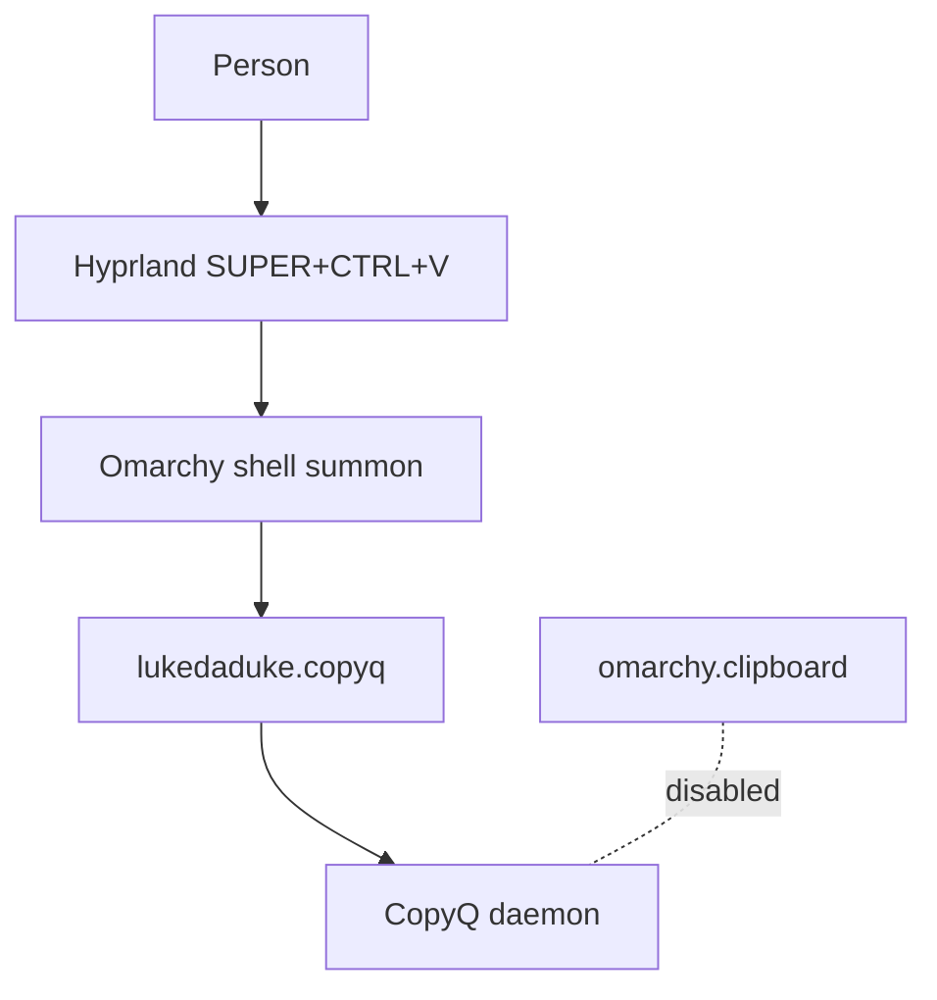
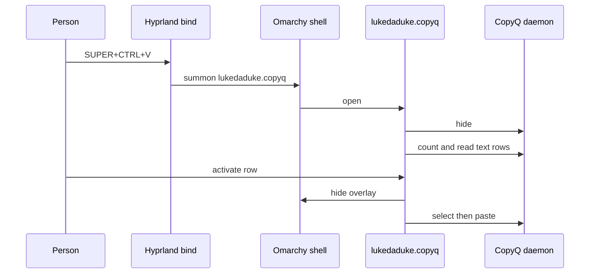
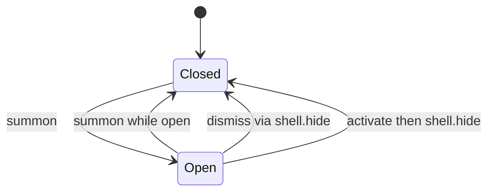

# CopyQ Omarchy Overlay - Plan

## Goal Capsule

- **Objective:** Pressing SUPER+CTRL+V shows a clipboard list that matches the rest of the Omarchy shell, and the chosen text clip is the one CopyQ already stored.
- **Means:** An Omarchy Quickshell overlay over stock CopyQ, with CopyQ kept headless (KTD1).
- **Authority:** Product Contract requirements win on behavior. Key Technical Decisions win on mechanism inside those requirements. Implementation units override neither. Session-settled decisions stay as written.
- **Execution profile:** Code change in this worktree. Helper tests first. The chord is proved by using it on the machine, because overlay QML cannot be type-checked against `qs.Commons` here.
- **Finish and ship:** Implement only in this worktree (`feat/copyq-omarchy-overlay`). The other checkout on `feat/nordvpn-widget` stays untouched.
- **Stop:** Leave the packaged Omarchy tree alone, as `AGENTS.md` requires. Leave the CopyQ package alone. Put no theme hex in the overlay. Do not commit machine Hyprland files into this repository.

---

## Product Contract

### Summary

`lukedaduke.copyq` becomes the clipboard surface for SUPER+CTRL+V. Stock CopyQ keeps the history and the MCP service, and its main window stays hidden on that chord. The plugin is catalogued, linked into the local shell, and covered by helper tests.

### Problem Frame

SUPER+CTRL+V on this machine already bypasses the stock Omarchy clipboard panel. The binding runs `copyq toggle`, so the person gets CopyQ's own Qt window. That window cannot take the shell's fonts, spacing, or icon treatment when the Omarchy theme changes. CopyQ is already the daemon that stores history and serves MCP. The gap is the surface, not a second clipboard store.

### Key Decisions

- KD1. SUPER+CTRL+V shows the Omarchy overlay alone. (session-settled: user-directed — chosen over keeping a stock picker as fallback on the same chord: two pickers on one chord fight the native overlay.) Governs R1.
- KD2. The overlay follows the active Omarchy theme. (session-settled: user-directed — chosen over a custom One Dark or hardcoded palette: the overlay must follow theme switches.) Governs R4.
- KD3. CopyQ's package stays the history store and the MCP service. (session-settled: user-approved — chosen over modifying or forking the CopyQ C++ UI: the CLI already covers list, select, and paste.) Governs R5.
- KD4. CopyQ is the only clipboard history owner, and the overlay is the UI. (session-settled: user-directed — chosen over leaving `omarchy.clipboard` as the history owner: the estate rule is one history owner, and that owner is now CopyQ.) Governs R6.

### Requirements

**Picker**

- R1. SUPER+CTRL+V opens `lukedaduke.copyq` and does not open the CopyQ main window, `omarchy.clipboard`, or `io.github.idr4n.clipboard-plus`.
- R2. The overlay lists recent text clips from the running CopyQ daemon and filters those loaded rows locally.
- R3. Activating a row selects it in CopyQ and attempts a paste. Copy-only activation selects it onto the clipboard and does not paste.
- R4. Colors, fonts, and spacing come from `qs.Commons` `Color` and `Style`. The overlay contains no theme hex.

**History**

- R5. The CopyQ package is unchanged. Its daemon keeps clipboard history and MCP.
- R6. `omarchy.clipboard` does not record a second history while this overlay is in use.

**Packaging and safety**

- R7. The plugin installs from this worktree with `scripts/install.sh --link`, has a `catalog.json` row, and its helpers are covered by `tests/test_copyq.py`.
- R8. Every clip string rendered in the overlay is plain text.
- R9. Using the overlay leaves the CopyQ main window hidden.

### Actors

- A1. The person at the keyboard.
- A2. The CopyQ daemon, which stores history and serves MCP.
- A3. The Omarchy shell, which summons and hides the overlay.

### Key Flows

- F1. Paste from the chord
  - **Trigger:** A1 presses SUPER+CTRL+V while A2 is running.
  - **Steps:** A3 summons `lukedaduke.copyq`. The overlay hides A2's main window, loads text rows, and A1 activates one. The overlay dismisses, A2 selects that row, and A2 attempts the paste.
  - **Outcome:** The chosen text is on the clipboard, and the Qt window did not appear. Covers R1, R2, R3, R9.
- F2. Dismiss without a paste
  - **Trigger:** A1 presses Esc.
  - **Steps:** The overlay closes and tells A3 to hide `lukedaduke.copyq`.
  - **Outcome:** A later summon opens it again. Covers R1.

### Acceptance Examples

- AE1. Covers R1, R9. Given CopyQ is running and its main window is closed, when A1 presses SUPER+CTRL+V, the overlay is visible and the CopyQ main window stays hidden.
- AE2. Covers R2. Given the CopyQ executable the list helper requires is missing, when the overlay loads history, it shows a failure state and does not crash.
- AE3. Covers R3. Given a text row is highlighted, when A1 activates it copy-only, CopyQ selects that row and does not paste.
- AE4. Covers R4, R8. Given a clip contains characters that would matter in rich text, the row renders as plain text in Commons colors.

### Success Criteria

On this machine, with the CopyQ daemon already running, SUPER+CTRL+V shows the overlay and the chosen text row is on the clipboard. The surface that appeared is the overlay.

### Scope Boundaries

- The scaffold under `plugins/lukedaduke.copyq/` is the starting point: `manifest.json`, `Overlay.qml`, `bin/copyq-list.py`, and `bin/copyq-activate.sh`.
- Image and binary clip previews stay out of this version.
- SUPER+SHIFT+V (`copyq menu`) and SUPER+ALT+V (`copyq next`) stay as they are.
- `io.github.idr4n.clipboard-plus` stays enabled and stays in the bar unless it records history. That disable is U5, not R6. R6 names only `omarchy.clipboard`.
- A failed paste does not grow a new toast. Selection has already updated the clipboard.
- The overlay does not re-read the row immediately before activate. A clip copied while the overlay is open can move indexes.
- The activate path stays on `execDetached`. The contract checker warns about that and about a raw `Process`. Those warnings are not CI errors. A shared `DeadlineProcess` wrapper is not part of this work. Evidence that would pull it in: CI invoking `scripts/check-plugin-contract.py --strict`.
- `docs/plans/2026-09-23-001-feat-active-plugin-estate-plan.md` stays as history. The living owner record is `docs/data-lifecycle.json`.

#### Deferred to Follow-Up Work

- Image and binary row preview.
- A `preview.png` and a scorecard moved from `pending` to assessed passes.
- A subtree push through `scripts/publish.sh` after the public repository exists.

### Sources

- `plugins/lukedaduke.copyq/Overlay.qml` already themes with `Commons.Color` and `Style`, lists through `bin/copyq-list.py`, and activates through `bin/copyq-activate.sh`. It also calls `copyq toggle` from an in-overlay shortcut, and `close()` does not call `shell.hide`.
- `plugins/lukedaduke.standby/Standby.qml` dismisses with `shell.hide`. `plugins/lukedaduke.standby/README.md` summons with `omarchy-shell shell summon lukedaduke.standby`.
- `AGENTS.md` requires `qs.Commons` `Color` / `Style` and `scripts/install.sh --link` for development.
- `scripts/check-release-readiness.py` requires `LICENSE`, `README.md`, a catalog row, matching version, and a non-empty `repo`. `.github/workflows/ci.yml` runs that script, `scripts/check-plugin-contract.py`, `scripts/check-scorecard.py`, and `python -m pytest tests/ -q`.
- `scripts/check-plugin-contract.py` treats a `Text` binding without `Text.PlainText` as an error. `execDetached` and a raw `Process` are warnings unless the plugin is strict.
- `scripts/check-scorecard.py` errors when `docs/reviews/<id>.md` has no scorecard block. Pending criteria pass when the script is run without `--release`, which is how CI invokes it.
- `docs/data-lifecycle.json` still sets clipboard `owner` to `omarchy.clipboard`.
- `machine/INDEX.md` points at the live Hyprland config and `shell.json`. The live chord unbinds SUPER+CTRL+V and binds it to `copyq toggle`. The stash copy matches. CopyQ 17 on this machine supports `hide`, and `hide_main_window` is already true. The host `disabledPlugins` list does not include `omarchy.clipboard`. `io.github.idr4n.clipboard-plus` is an enabled plugin.
- `catalog.json` rows use `https://github.com/duketopceo/omarchy-<name>`. `scripts/publish.sh` maps the same plugins to `git@github.com:duketopceo/omarchy-<name>.git`.

---

## Planning Contract

### Key Technical Decisions

- KTD1. The picker is the Quickshell overlay `lukedaduke.copyq`, talking to stock CopyQ 17 through `count`, `read`, `select`, `paste`, and `hide`. (session-settled: user-directed — chosen over heavy CopyQ theming and forking CopyQ: Qt chrome cannot match Omarchy fonts and icons.) Implements KD3. Governs R1, R5, R9.
- KTD2. Theme tokens are `Commons.Color` and `Style` only. (session-settled: user-directed — chosen over a custom One Dark or hardcoded palette: the overlay must follow Omarchy theme switches.) Implements KD2. Governs R4.
- KTD3. Change the existing SUPER+CTRL+V command from `copyq toggle` to `omarchy-shell shell summon lukedaduke.copyq`. Edit the stash-canonical bindings first, then the live file. The overlay calls `copyq hide` when it opens and does not call `copyq show` or `copyq toggle`. (session-settled: user-directed — chosen over keeping a stock picker as fallback on the same chord: two pickers on one chord fight the native overlay.) Implements KD1. Governs R1, R9. Conflict: the binding file is outside this repository, so the plugin diff alone does not switch the chord. That matches the open ownership note: the implementer follows the machine stash-canonical rule. The product code stays in this repo.
- KTD4. Add `omarchy.clipboard` to the host shell disabled-plugin list, and set the clipboard `owner` in `docs/data-lifecycle.json` to the CopyQ daemon with `lukedaduke.copyq` named as the UI. Leave the retention, pause, delete, and export sentences unchanged until CopyQ's actual controls are read. If `io.github.idr4n.clipboard-plus` stores history, disable it in that same host list. A bar slot by itself does not. (session-settled: user-directed — chosen over leaving `omarchy.clipboard` as the history owner: one history owner, and that owner is CopyQ.) Implements KD4. Governs R6. The clipboard-plus clause is the conditional in U5. It does not widen R6.

Summon versus a direct IPC toggle did not need a bake-off. Standby already documents `omarchy-shell shell summon` for overlays, and reversing it is a one-line binding change.

### High-Level Technical Design

### Assumptions

- SUPER+SHIFT+V and SUPER+ALT+V stay. They are not the picker chord in R1.
- `io.github.idr4n.clipboard-plus` is a bar companion until an implementer sees it store history. History capture makes R6 disable it.
- The public repository name follows the sibling pattern `omarchy-copyq` under `duketopceo`. The house repository-creation wrapper creates it. A bare GitHub create does not.
- Paste stays best-effort, as `bin/copyq-activate.sh` already treats a failed paste.
- History reloads when the overlay opens, not again at activate.
- `docs/data-lifecycle.json` retention text is not rewritten to a guessed CopyQ policy.

### Sequencing

U2 can start immediately. U1 can start immediately. U3 creates the public repository before it writes the catalog `repo` field. U4 is independent. U5 smoke waits on U1, U2, and U4. U3 is required before CI and the Definition of Done, not before the chord check.

### System-Wide Impact

Clipboard history ownership moves from `omarchy.clipboard` to the CopyQ daemon. The host shell disables `omarchy.clipboard`. The machine Hyprland chord stops calling `copyq toggle`. MCP stays on CopyQ. This plugin does not add an MCP server. CI will fail until the new plugin has a license, README, catalog `repo`, plain-text clip rendering, and a scorecard block.

### Risks

- Paste can miss the focused window because the overlay closes before `copyq paste` runs. The row is still selected onto the clipboard. R3 accepts that.
- An index captured at open can point at a different clip if the history changes while the overlay is up. R2 does not add a second read.
- Editing the live Hyprland file before the stash copy lets the machine sync restore `copyq toggle`. KTD3 requires stash first.
- `io.github.idr4n.clipboard-plus` can still sit on the bar. It must not own SUPER+CTRL+V. If it stores history, U5 disables it under KTD4.

---

## Implementation Units

### U1. Overlay dismiss, hide, and plain text

- **Goal:** The overlay dismisses through the shell, never opens the CopyQ window, and renders clip text as plain text.
- **Requirements:** R1, R2, R3, R4, R8, R9. Mechanism: KTD1, KTD2, KTD3.
- **Dependencies:** none
- **Files:** `plugins/lukedaduke.copyq/Overlay.qml`
- **Approach:**
  1. Route close, Esc, scrim click, and activate through a dismiss path that calls `shell.hide` with the manifest id, matching `plugins/lukedaduke.standby/Standby.qml`.
  2. Remove the in-overlay `copyq toggle` action and the footer hint that advertises it. Leave hints only for the actions that remain.
  3. A summon while the overlay is open runs `toggle` and dismisses. The first summon opens it.
  4. Ask CopyQ to hide its main window when the overlay opens.
  5. Set plain text on every `Text` item that binds `text`.
  6. Keep the existing Commons color and Style spacing. Add no theme hex.
- **Patterns to follow:** `plugins/lukedaduke.standby/Standby.qml` dismiss and `shell.hide`.
- **Test scenarios:**
  - Happy path: opening the overlay requests `copyq hide` and loads rows through the existing list helper.
  - Happy path: Esc and a scrim click each end with the overlay closed and `shell.hide` called for `lukedaduke.copyq`.
  - Happy path: a summon while the overlay is open dismisses it.
  - Happy path: activating a row dismisses first, then runs `bin/copyq-activate.sh` with that row's CopyQ index.
  - Edge: copy-only activation passes the copy-only flag and does not request a paste.
  - Error: a list payload with `ok` false shows the error string and an empty list.
  - Integration: after dismiss, a second summon opens the overlay again.
- **Verification:** On device, SUPER+CTRL+V after U5 shows the overlay, Esc closes it, and a second press opens it again. The CopyQ main window stays hidden. `scripts/check-plugin-contract.py` reports no plain-text error in this file.

### U2. Helper tests

- **Goal:** The list and activate helpers keep the text-row contract under test.
- **Requirements:** R2, R3, R7
- **Dependencies:** none
- **Files:** `tests/test_copyq.py`, `plugins/lukedaduke.copyq/bin/copyq-list.py`, `plugins/lukedaduke.copyq/bin/copyq-activate.sh`
- **Approach:** Add `tests/test_copyq.py` in the style of `tests/test_standby.py`, loading the helpers from `plugins/lukedaduke.copyq/bin/` and stubbing the CopyQ process. Change a helper only when a test shows it violates R2 or R3.
- **Execution note:** Write these tests first against the current scripts. The limit, preview-length, and blank-row cases lock today's helper behavior. They are not new rules beyond R2 and R3.
- **Patterns to follow:** `tests/test_standby.py`
- **Test scenarios:**
  - Happy path: CopyQ `count` is 2 and the two `read` calls return `alpha` and `beta`. The JSON has `ok` true, `count` 2, and entries at indexes 0 and 1 with those texts.
  - Happy path: activate with `--index 1` runs `select 1` and then `paste`.
  - Happy path: activate with `--index 1 --copy-only` runs `select 1` and does not run `paste`.
  - Edge: a `read` that returns only whitespace is omitted, and later indexes stay the CopyQ indexes.
  - Edge: a `read` with a nonzero status is omitted.
  - Edge: a preview longer than 160 characters is cut and marked with an ellipsis.
  - Edge: limit argument `0` lists one row. A non-numeric limit uses 80. A limit above 200 uses 200.
  - Error: when the CopyQ binary is absent, the list helper prints `ok` false, error `copyq_missing`, an empty `entries` array, and exits 1.
  - Error: a non-numeric `count` prints `ok` false and exits 1.
  - Error: activate without a numeric `--index` exits 2.
  - Error: activate when the CopyQ binary is absent exits 1.
- **Verification:** `python -m pytest tests/test_copyq.py -q` passes.

### U3. Catalog, docs, scorecard, and repository URL

- **Goal:** The plugin satisfies the family's release files, catalog row, and scorecard presence, with a real repository URL.
- **Requirements:** R5, R7. Theme claim in the README follows KTD2.
- **Dependencies:** none
- **Files:** `catalog.json`, `README.md`, `plugins/lukedaduke.copyq/README.md`, `plugins/lukedaduke.copyq/LICENSE`, `plugins/lukedaduke.copyq/AGENTS.md`, `docs/reviews/lukedaduke.copyq.md`, `scripts/publish.sh`
- **Approach:**
  1. Create the public repository with the house repository-creation wrapper, named `omarchy-copyq`, matching sibling repos. Do not use a bare create.
  2. Add a `catalog.json` row for `lukedaduke.copyq` at version `0.1.0`, kind `overlay`, path `plugins/lukedaduke.copyq`, and `repo` `https://github.com/duketopceo/omarchy-copyq`.
  3. Add the matching `git@github.com:duketopceo/omarchy-copyq.git` entry in `scripts/publish.sh`.
  4. Add MIT `LICENSE`, a plugin `README.md`, and a plugin `AGENTS.md` following `plugins/lukedaduke.standby/`. The README states the summon command, the CopyQ dependency, text-only rows, and best-effort paste.
  5. Add a root `README.md` table row and repository link.
  6. Add `docs/reviews/lukedaduke.copyq.md` with a scorecard block whose plugin id is `lukedaduke.copyq` and whose criteria keys match `docs/reviews/lukedaduke.standby.md`, all `pending`.
- **Patterns to follow:** `catalog.json` standby row, `plugins/lukedaduke.standby/README.md`, `plugins/lukedaduke.standby/AGENTS.md`, `docs/reviews/lukedaduke.standby.md` scorecard block.
- **Test scenarios:**
  - Happy path: catalog version `0.1.0` equals the manifest version.
  - Happy path: catalog `repo` is the non-empty `omarchy-copyq` URL, and `scripts/publish.sh` maps the same id.
  - Happy path: `docs/reviews/lukedaduke.copyq.md` contains a parseable scorecard block for `lukedaduke.copyq`.
  - Error: a catalog row without `repo` is what `scripts/check-release-readiness.py` already rejects. This unit does not land that shape.
- **Verification:** `python scripts/check-release-readiness.py` and `python scripts/check-scorecard.py` exit 0.

### U4. Clipboard owner record

- **Goal:** The living lifecycle record names CopyQ as the clipboard store and the overlay as the UI.
- **Requirements:** R5, R6. Mechanism: KTD4.
- **Dependencies:** none
- **Files:** `docs/data-lifecycle.json`
- **Approach:** Change the clipboard `owner` so it identifies the CopyQ daemon and names `lukedaduke.copyq` as the UI. Keep the existing retention sentence until CopyQ's configured limits are known. Do not edit `docs/plans/2026-09-23-001-feat-active-plugin-estate-plan.md`.
- **Test scenarios:**
  - Happy path: the clipboard entry parses and its owner no longer reads `omarchy.clipboard`.
  - Edge: the retention field is still the previous sentence.
- **Verification:** The clipboard object in `docs/data-lifecycle.json` matches that owner wording.

### U5. Link install, chord, and one history owner

- **Goal:** This machine opens the overlay on SUPER+CTRL+V, and `omarchy.clipboard` is not a second watcher.
- **Requirements:** R1, R6, R7, R9. Mechanism: KTD3, KTD4.
- **Dependencies:** U1, U2, U4. U3 gates CI and the Definition of Done, not this smoke.
- **Files:** none in this repository. `machine/INDEX.md` identifies the live Hyprland config and the host shell file. Edit the stash-canonical bindings, then the live bindings.
- **Approach:**
  1. Run `scripts/install.sh --link` from this worktree and rescan plugins.
  2. Enable `lukedaduke.copyq` in the host shell if a rescan does not already load it.
  3. Replace the SUPER+CTRL+V command `copyq toggle` with `omarchy-shell shell summon lukedaduke.copyq` in the stash bindings, then in the live bindings.
  4. Add `omarchy.clipboard` to the host shell disabled-plugin list.
  5. If `io.github.idr4n.clipboard-plus` stores history, disable it too. Otherwise leave its bar slot.
  6. Leave the CopyQ autostart that runs `copyq --start-server` in place.
- **Execution note:** This is machine configuration plus a live smoke. Prove the chord on the desktop after the link install. Do not commit the Hyprland files into this repo.
- **Patterns to follow:** `machine/INDEX.md` for where the live files sit. `plugins/lukedaduke.standby/README.md` for the summon command.
- **Test scenarios:**
  - Happy path: after the link install, SUPER+CTRL+V shows the overlay and hides the CopyQ window. Enter on a text row leaves that text on the clipboard.
  - Happy path: Esc closes the overlay, and the next SUPER+CTRL+V opens it again.
  - Happy path: SUPER+CTRL+V while the overlay is open dismisses it.
  - Edge: SUPER+SHIFT+V and SUPER+ALT+V still run their existing CopyQ commands.
  - Integration: `omarchy.clipboard` is in the disabled-plugin list, and the CopyQ daemon is still running.
- **Verification:** AE1 and the Success Criteria hold on this machine. The stash binding and the live binding both summon `lukedaduke.copyq`.

---

## Verification Contract

| Check | Command or action | Units |
| --- | --- | --- |
| Manifests | `python scripts/validate-manifests.py` | U3 |
| Helper tests | `python -m pytest tests/test_copyq.py -q` | U2 |
| Plugin contract | `python scripts/check-plugin-contract.py` | U1 |
| Release files | `python scripts/check-release-readiness.py` | U3 |
| Scorecard presence | `python scripts/check-scorecard.py` | U3 |
| Full test module | `python -m pytest tests/ -q` | U2, U3 |
| Chord smoke | SUPER+CTRL+V on this machine with CopyQ already running | U5 |

`scripts/check-plugin-contract.py` may still warn about `execDetached` and a raw `Process`. Those warnings do not fail this plan. Errors do.

---

## Definition of Done

- R1 through R9 hold, including AE1 on this machine.
- U2's pytest module passes, and the CI checks in the Verification Contract exit 0.
- The catalog `repo` is the real `omarchy-copyq` repository, created with the house wrapper.
- The stash binding was edited before the live binding, and both summon `lukedaduke.copyq`.
- `omarchy.clipboard` is disabled on the host, and `docs/data-lifecycle.json` names the CopyQ daemon as the clipboard owner.
- If `io.github.idr4n.clipboard-plus` stores history, it is disabled too. A bar slot alone can remain.
- Abandoned experiments are not left in the diff. The nordvpn checkout is unchanged.
