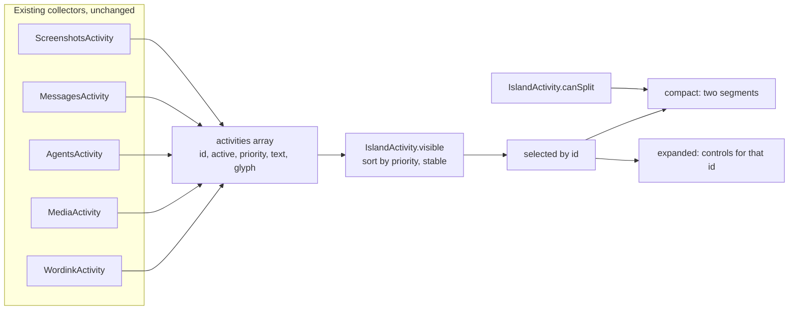
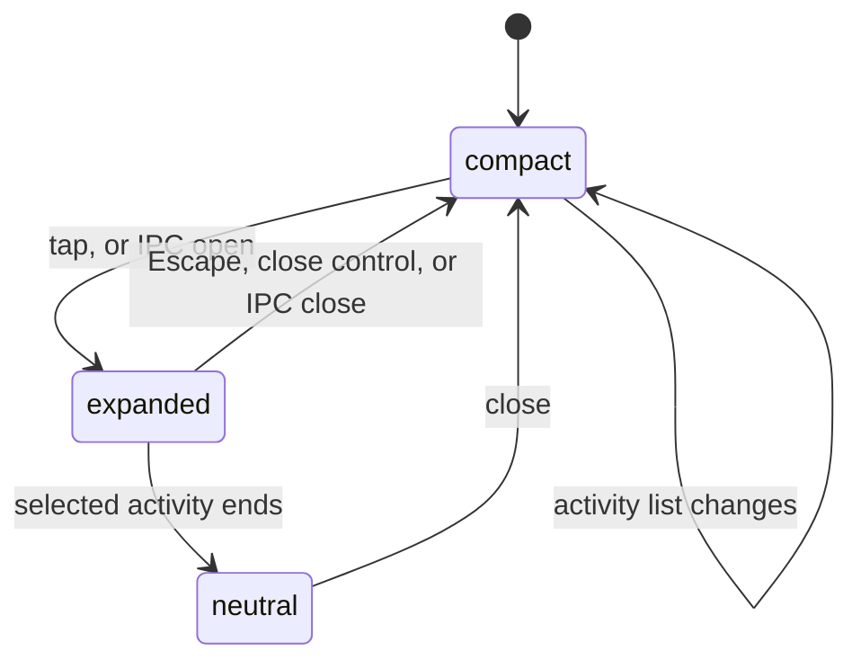
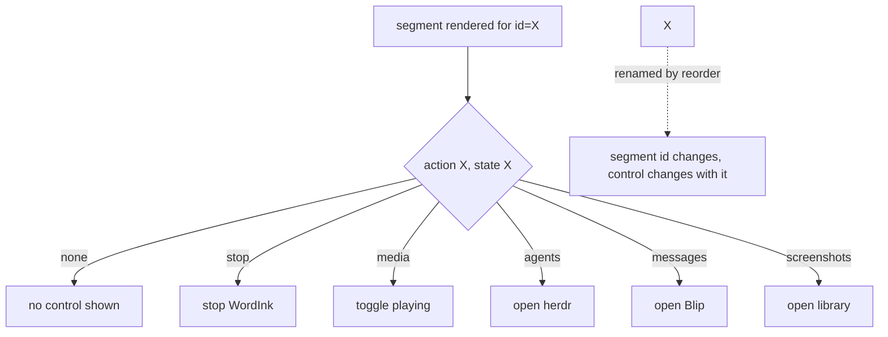

# Merge Notch activity integrations into the native Island - Plan

## Goal Capsule

- **Objective:** When something is happening on the laptop — dictation running, media playing, an agent blocked, a message arriving, a screenshot captioned — the notch shows it as a live activity with a control that acts on that activity, and the compact/expanded island replaces the dashboard as what a glance reveals.
- **Means:** Add `Island.qml` beside the existing panel and point the manifest at it, reusing the five activity collectors unchanged (KTD2).
- **Authority:** Product Contract wins on behavior; Key Technical Decisions win on mechanism; units override neither.
- **Stop conditions:** Stop if a collector needs rewriting to fit the Island, if the change would alter a saved setting's meaning, or if the old panel cannot be reached from the new surface.
- **Execution profile:** One plugin, Linux/Quickshell only, node + pytest + QML parse checks. The live visual check is the one manual step.
- **Who finishes:** One PR on `feature/island-activity-merge`.

## Product Contract

Product Contract unchanged.

### Summary

Replace the Notch plugin's primary dashboard presentation with the tested standalone Island direction while retaining real activity integrations and existing settings. Deliver as a reviewable plugin change; do not alter the user's live prototype automatically.

### Problem Frame

The notch today is a side-text slot with an eleven-tab dashboard behind it. Nine of those tabs (network, power, system, stocks, plugins, weather, and their siblings) answer questions nobody asks at a glance, while the five things that actually change minute to minute — dictation, media, agents, messages, screenshots — compete for one line of text. The standalone `prototypes/island-v02` proved a compact/expanded island with real media control reads better. It has no integrations and no settings, so it cannot ship.

### Requirements

**Presentation**

- R1. Use compact and expanded Island presentations, with an idle clock and date and the native prototype's camera-aware placement. Show two eligible activities when space permits, prioritizing dictation, media, agent attention, messages, and screenshots using the existing integration priorities.
- R2. Expanded content is activity-focused: playback controls for media, a stop action during active dictation, a route to herdr for agents, Blip for messages, and the screenshot library for screenshots. Show actions only when their real backend is available.
- R3. Do not bring network, power, system, stocks, weather, or plugin-management tabs into the Island's main flow. Existing independent widgets remain available; the old implementation and configuration remain recoverable.

**Compatibility and safety**

- R4. Keep the existing plugin ID, saved opt-in settings, monitor/cutout detection, and safe fallback on narrow or external displays. Preserve reduced-motion behavior, keyboard dismissal, and usable screen-reader labels. Never invent live data.
- R5. Keep a small setup route outside the primary activity flow so new installs can explicitly enable agents, messages, and screenshots. Expose an IPC entry point that opens and focuses the Island for keyboard use; activity targets must be focusable and support Enter/Space, and Escape must dismiss without taking focus on hover.
- R6. Preserve an explicit secondary route to the existing dashboard. Some deployments use `notch-slim-bar` and may otherwise lose their only configured network or finance controls. Do not alter the bar layout automatically.

### Key Decisions

- **Existing integration priorities govern activity order, not the order listed in R1.** R1's enumeration reads dictation, media, agents, messages, screenshots; the collectors carry dictation 90, agents 80 (blocked) / 40 (done), messages 70, media 50, screenshots 30. The plan follows the numbers. Governs R1.
- **The old panel stays in source and reachable.** Deleting it would strand `notch-slim-bar` deployments whose only network or finance control lives in its tabs. Governs R3, R6.

### Success Criteria

- On the internal screen, an active dictation, playing media, or blocked agent is visible in the compact island without opening anything.
- Expanding shows a control that acts on the activity that is showing, and that control never acts on a different activity.
- The dashboard remains reachable and unchanged in behavior.

### Scope Boundaries

**Deferred to Follow-Up Work**

- Porting any dashboard tab's content into the Island's expanded state.
- Camera calibration for panels other than `omarchy-max`; the prototype's 186 px internal / 95 px external widths carry over as defaults.

**Outside this plan**

- Following a non-default snapdex library path from the island's Library control. `ScreenshotsActivity` holds no snapdex panel JSON, so `libraryDir` reveals the conventional `~/Pictures/Screenshots/Library`; the dashboard's "Open folder" follows snapdex's reported path. Making them agree needs a panel read on the activity, which is a new backend call rather than reuse.
- Lifting Notch.qml's `notch` IpcHandler so the dashboard can load without a duplicate-registration warning. It needs an edit to Notch.qml, the rollback target, so it waits until the dashboard is either retired or re-pointed.
- The standalone prototype at `prototypes/island-v02/`; it keeps running untouched.
- Any new backend collector. The five existing ones are the whole integration surface.

### Open Questions

**Deferred to implementation (non-blocking)**

- Whether the expanded island reads the activity that is *selected* or the one that is *highest priority*. KTD6 requires the former; the panel geometry determines whether a selection affordance is needed at all.
- Exact split widths on a second monitor. The implementer measures against `Model.parseCutouts` rather than hardcoding.

## Planning Contract

### Key Technical Decisions

- KTD1. Preserve `io.github.duketopceo.notch` as the installed ID for configuration compatibility. Implement the new UI as a separate component and leave the old panel available in source for rollback.
- KTD2. Reuse `MediaActivity.qml`, `WordinkActivity.qml`, `AgentsActivity.qml`, `MessagesActivity.qml`, `ScreenshotsActivity.qml`, `Model.js`, and `Settings.js`; do not create parallel backend collectors.
- KTD3. Use Island 0.2's compact and expanded geometry and real media presentation, not a web runtime. `Activity.js` supplies deterministic selection; the split must fit calculated screen and bar space.
- KTD4. Route unavailable integrations to an honest empty state. Existing permission and opt-in boundaries remain unchanged.
- KTD5. Keep the standalone 0.2 prototype running until the replacement has passed verification; do not install a trial as a production change without verifying it.
- KTD6. Bind each visible segment to its activity ID, not its ranking position. When the selected activity ends, close its detail view or show a neutral state; never redirect a destructive or state-changing control to a different activity. Label WordInk's toggle as Stop only while recording.
- KTD7. Render all externally sourced activity text as plain text. Preserve the existing message allowlist, automation gate, and memory-only preview behavior, and cover markup-shaped input in regression tests.
- KTD8. Keep the existing dashboard reachable through a deliberate secondary action, and allow returning to the Island. Do not assume that separate bar widgets are enabled.

### High-Level Technical Design

Selection is pure and testable; rendering consumes it. The Island never reads a collector directly.

Compact and expanded are two states of one window, so dismissal and the ID binding are one rule.

Each segment's control is bound to its own activity ID, which is what keeps a destructive control from following a reordering (KTD6).

### Assumptions

- `display-cutouts.json` remains the cutout source; the prototype's sensor widths are correct for `omarchy-max` and a safe default elsewhere.
- Quickshell's `WlrLayerShell` keyboard focus can be granted on demand without stealing focus on hover, as the prototype already demonstrates.

## Implementation Units

### U1. Activity contract and routing

**Goal:** Deterministic selection, ID binding, and safe actions as pure logic.

**Requirements:** R1, R2.

**Files:** `plugins/io.github.duketopceo.notch/IslandActivity.js`, `tests/test_island_activity.py`.

**Approach:** Already implemented. `visible()` sorts by priority with a stable insertion so equal priorities keep list order; `selected(activities, id)` returns null when the ID is gone; `action(id, state)` returns `stop` only while recording; `canSplit()` requires real space for both segments.

**Test scenarios:**

- Priorities sort highest-first and equal priorities keep their original order; null input yields an empty list; inactive and empty-text entries are skipped.
- A selected ID absent from the list yields null rather than falling back to the top activity.
- `action('dictation', state)` returns `stop` for `recording` and null for `transcribing` and `done`.
- `canSplit` is true only when the fixed width plus both segments fits, and false when the second segment has zero width.

**Verification:** `uv run --offline --with pytest pytest -q tests/test_island_activity.py`

### U2. Native Island presentation

**Goal:** A compact/expanded island wired to the five collectors, replacing the dashboard as the primary surface.

**Requirements:** R1, R2, R3, R4, R5, R6.

**Dependencies:** U1.

**Files:** `plugins/io.github.duketopceo.notch/Island.qml` (new), `plugins/io.github.duketopceo.notch/manifest.json`, `plugins/io.github.duketopceo.notch/IslandActivity.js`, `tests/test_notch_island.py` (new).

**Approach:** Port `prototypes/island-v02/shell.qml` into a plugin component that receives `shell` and `manifest` like `Notch.qml` does. Keep the prototype's compact 37 px height and expanded geometry, and its camera-aware sensor widths. Build the activities array from the five existing collectors, exactly as `Notch.qml` does today, then feed it through `IslandActivity.visible`. Give each segment its own `TapHandler` bound to that segment's ID. Keep `Settings.js` reads, `IpcHandler` target `notch` with `open`/`close` beside the existing `openTab`/`close`, and a deliberate control that opens the old dashboard.

**Patterns to follow:** `plugins/io.github.duketopceo.notch/Notch.qml` for settings, cutouts, and IPC; `prototypes/island-v02/shell.qml` for geometry and motion.

**Execution note:** Keep the prototype runnable throughout; verify the plugin copy beside it rather than in place of it.

**Test scenarios:**

- The manifest keeps id `io.github.duketopceo.notch` and its entry point resolves to an existing file.
- A compact island with dictation active shows the dictation segment, and its control is labelled Stop only in the `recording` state.
- An activity that ends while expanded leaves a neutral state rather than showing another activity's controls.
- Two segments appear when `canSplit` passes and one when it fails; narrow screens fall back to the single-segment layout.
- Escape from expanded returns to compact, and no control takes keyboard focus on hover.
- Message text containing markup renders as literal text.

**Verification:** `python scripts/validate-manifests.py`, `python scripts/check-qml-syntax.py`, `pytest -q tests/test_notch_island.py tests/test_notch_tabs.py`

### U3. Documentation and verification

**Goal:** The README describes what actually ships, and the live surface is verified or the gap recorded.

**Requirements:** R3, R4, R6.

**Dependencies:** U2.

**Files:** `plugins/io.github.duketopceo.notch/README.md`.

**Approach:** Describe the Island as the primary surface, name each integration and the setting that enables it, document how to reach the dashboard and how to fall back to the old panel. Record which checks could not run on this machine.

**Test scenarios:**

- Test expectation: none -- documentation only.

**Verification:** `git diff --check`, and a live run on the internal screen.

## Verification Contract

| Gate | Command |
|---|---|
| Activity logic | `uv run --offline --with pytest pytest -q tests/test_island_activity.py` |
| Notch suite | `pytest -q tests/test_notch_tabs.py tests/test_notch_island.py tests/test_notch_media.py tests/test_notch_wordink.py tests/test_notch_agents.py tests/test_notch_messages.py tests/test_notch_screenshots.py tests/test_notch_sizes.py` |
| Manifest | `python scripts/validate-manifests.py` |
| QML parses | `python scripts/check-qml-syntax.py` |
| Whitespace | `git diff --check` |
| Live | Internal screen: compact shows a live activity; expanded control acts on it; Escape dismisses; dashboard reachable |

## Definition of Done

- Global: R1 to R6 hold, every gate above passes, and the live check is done or its absence recorded in the PR.
- Per unit: each unit's Verification is met and its test scenarios exist as tests.
- Cleanup: no prototype code left half-copied into the plugin, and no abandoned experiment in the diff.
