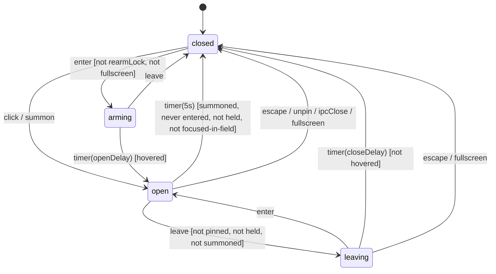
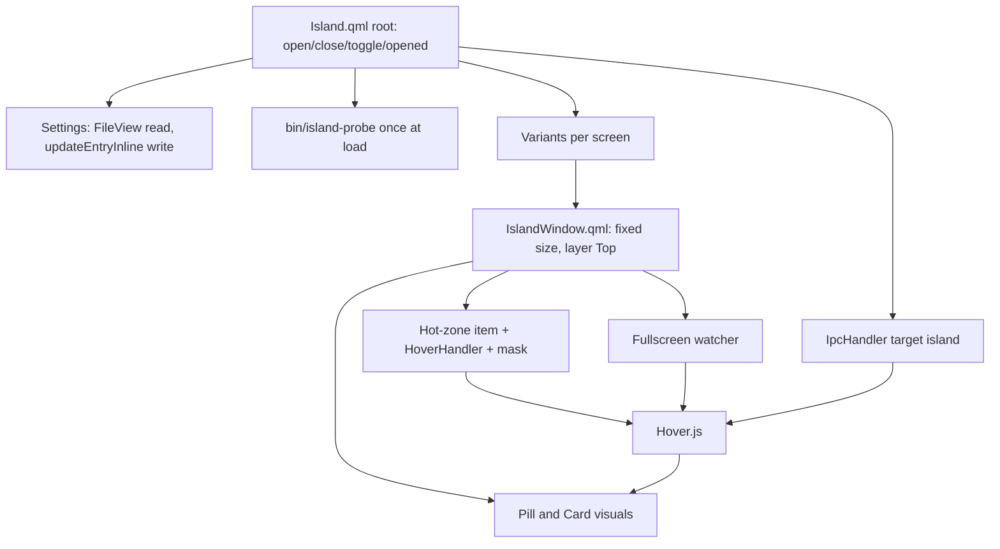

# Island - Plan

## Goal Capsule

- **Objective:** On every screen, one pill at the top center shows the time and what is happening now, opens when the pointer rests on it, and closes on its own when the pointer leaves, without the clutter or stuck-open behavior of the archived notch.
- **Means:** A new plugin, `io.github.duketopceo.island`, built fresh on the Omarchy dock's hover pattern: fixed-size window, state-driven input mask, one always-on hover source, and a pure tested state machine (KTD1–KTD4).
- **Authority:** Requirements (R) win on product behavior; Key Technical Decisions (KTD) win on mechanism; units override neither.
- **Stop conditions:** Stop if U1 shows Hyprland cannot deliver reliable hover enter/leave under the KTD2 mask scheme and the KTD3 fallback does not close the gap. Stop if any unit needs to write `bar.layout` or another plugin's entry in `shell.json`. Stop if a settled Key Decision proves infeasible; report it instead of working around it.
- **Execution profile:** Quickshell 0.3.2 QML plus ES5 logic modules tested with node through pytest; live checks on omarchy-max (eDP-1 3456x2234 at scale 2, DP-3 ultrawide at scale 1), Omarchy 4.5, Hyprland 0.57.1.
- **Who finishes:** P1 (U1–U8) ships as one PR off `main`. P2–P5 each get their own `ce-plan` pass and PR.

---

## Product Contract

### Summary

This plan builds P1 of the Island: the pill on every screen, the hover contract, clock and date ears, the settings page, the capability probe, IPC and fullscreen step-aside, down to files, tests and live checks. P1 starts with live probes on this laptop that pick between the planned mechanism and its named fallbacks. P2–P5 (live activities, core pages, personal integrations, notifications and publish) are listed in the Feature catalog and each gets its own plan before its PR.

### Problem Frame

Two products sat at the top of the screen and neither worked well: the tabbed notch (`io.github.duketopceo.notch`) and the `island-v02` prototype, both now in `archive/`. The notch had the features but showed a 15-tab strip and a crowded Home tab, and its hover never closed on its own. The cause was concrete: its only hover detector was turned off the moment the panel opened (`archive/notch/plugin/Island.qml`, `HoverHandler { enabled: !win.expanded }`), so leaving was never seen, and click-to-pin plus a full-screen click catcher were added as workarounds. Its bar-slimming script also removed widgets from the bar, and uninstalling the notch left them gone. The prototype looked right but had no integrations or settings.

### Key Decisions

- **Fresh build; the archive is reference only.** (session-settled: user-directed — chosen over porting the archived notch code: the old code carried the hover defect and the clutter.) Governs R1.
- **Hover opens, leaving closes, both after a delay.** (session-settled: user-directed — chosen over click-to-pin as the open model: the old click-to-pin left panels stuck open.) Governs R5, R6, R7, R8, R9, R10, R11, R12.
- **The Island owns the bar's top center.** (session-settled: user-directed — chosen over a camera-width pill without ears and over a pill hanging below the bar: keeps time and activity glanceable.) Governs R4.
- **The Island never edits the bar layout.** (session-settled: user-approved — chosen over a bar-slimming script like `notch-slim-bar`: uninstalling the notch left widgets missing.) Governs R4, R21.
- **Hard clutter budget.** (session-settled: user-approved — chosen over a full tab dashboard: the 15-tab strip was the clutter.) Governs R14, R15, R16.
- **Notifications and OSD stay with Omarchy unless the owner opts in.** (session-settled: user-approved — chosen over always claiming the notification service: only one owner can exist.) Governs R19.
- **New plugin id `io.github.duketopceo.island`.** (session-settled: user-approved — chosen over reusing `.notch`: keeps the archived entry and settings from leaking in.) Governs R1.

### Requirements

**Shell**

- R1. The Island is a new Omarchy panel plugin, `io.github.duketopceo.island`, written fresh; files under `archive/` are read for knowledge, never copied.
- R2. Each screen gets its own island at the top center: centered on the camera cutout on MacBook panels, a virtual pill of the same shape elsewhere.
- R3. The compact pill shows the time in the left ear and, in the right ear, the top live activity or else the date.
- R4. The pill covers the bar's center; the README gives the owner the one command that turns off `omarchy.clock`, and the Island never runs it.

**Open and close**

- R5. The card opens when the pointer rests in the hot zone for `openDelay` (default 140 ms, setting range 0–600); moving out first cancels.
- R6. The card closes after the pointer has been outside the hot zone for `closeDelay` (default 450 ms, setting range 150–1500); coming back first cancels.
- R7. The card never closes while the pointer is over it, including during the open and close animation and while the pointer is on a control inside the card.
- R8. A click on the compact pill opens the card at once without pinning; a click on the card body also gives it keyboard focus, so Esc closes and Tab moves between controls.
- R9. Only the card's pin control pins; a pinned card ignores the pointer leaving, and Esc or the pin control unpins and closes it.
- R10. The card stays open while a slider or scrub drag is in progress or a text field has focus; when that ends with the pointer outside, the close delay starts.
- R11. Opening by IPC or keybinding opens the card on the screen under the pointer and keeps it open until the pointer has entered and left the card, or 5 s pass untouched.
- R12. After Esc, a pin-close or an IPC close with the pointer still inside, the card does not reopen until the pointer leaves and enters again.
- R13. With reduced motion on, the morph snaps; the timing rules above are unchanged.

**Clutter budget**

- R14. The right ear shows one thing; idle rotation (weather, quote) is opt-in and off by default.
- R15. The compact pill shows at most 2 live activities, the second as an icon only.
- R16. The expanded card has one fixed size: the top activity's controls, then up to 2 more activity rows, then a page row of at most 5 chips (Now plus the owner's top 3 enabled pages, plus one "More" chip when further pages are enabled); a page appears only when its integration is enabled and detected.

**Fullscreen, settings and boundaries**

- R17. When a monitor shows a real fullscreen window, the island on that monitor is hidden, including live activities, and hover there does nothing.
- R18. Settings live in this plugin's own `shell.json` entry and cover both delays, every integration toggle and page order; a missing tool hides its feature and never shows an error.
- R19. Notifications stay with Omarchy unless the owner opts in (P5); the OSD stays with Omarchy unless the owner opts in (P2).
- R20. A capability probe runs once at load, checks only that tools and files exist, and makes no network calls.
- R21. The Island writes nothing in `shell.json` outside its own `plugins[]` entry.
- R22. P2–P5 deliver the activities and pages in the Feature catalog below.

### Acceptance Examples

- AE1. Covers R5, R6. **Given** the card is closed, **when** the pointer rests on the pill for 200 ms, **then** the card opens; **when** it then leaves for 500 ms, **then** the card closes.
- AE2. Covers R6, R7. **Given** the card is opening, **when** the pointer moves from the pill onto the card area mid-animation, **then** the card stays open.
- AE3. Covers R8, R9. **Given** the card was opened by a click on the pill, **when** the pointer leaves, **then** it closes after the delay; **given** the pin control was pressed, **when** the pointer leaves, **then** it stays open.
- AE4. Covers R11. **Given** the pointer is on another window, **when** the owner presses the Island keybinding, **then** the card opens on that screen and stays open until the pointer has visited it and left, or 5 s pass.
- AE5. Covers R12. **Given** the card is open with the pointer inside, **when** the owner presses Esc, **then** the card closes and does not reopen until the pointer leaves and returns.
- AE6. Covers R17. **Given** a video goes fullscreen on DP-3, **then** the DP-3 island disappears and the eDP-1 island is unaffected.

### Success Criteria

- The live hover check (U6) passes on both eDP-1 and DP-3 in 20 consecutive runs, with no open or close the script did not cause.
- A clean P1 install shows the pill, opens on hover, closes on leave, and shows only the Now and Settings chips.

### Feature Catalog

Status column: what the archived notch had, for reference only.

**Shell (P1)**

| Feature | Notes | Notch had |
|---|---|---|
| Pill geometry | Camera-centered on MacBook cutouts, virtual pill elsewhere, one per screen | yes |
| Hover contract | R5–R13 | partial |
| Clock and date ears | 12/24 h; date in the right ear when idle | yes |
| Theme | `Commons.Color` / `Commons.Style`, reduced motion | yes |
| Settings page | R18 | yes |
| Capability probe | R20 | yes |
| IPC | `toggle`, `open <page>`, `close`, `focus`, `state` | partial |
| Fullscreen step-aside | R17 | v0.5.0 |
| Multi-monitor | Independent state per screen | yes |

**Live activities (P2, P4, P5)**

| Activity | Source | Expanded controls | Priority | Phase |
|---|---|---|---|---|
| Dictation | `wordink` CLI state | Stop | 90 | P2 |
| Notifications | Opt-in host; requires `omarchy.notifications` in `disabledPlugins` | Card with actions | 85 | P5 |
| Volume / brightness HUD | PipeWire / backlight; opt-in, replaces `omarchy.osd` only when the owner disables it | Level bar | 80 (brief) | P2 |
| Timer | Island's own timer | Pause, +1 min, cancel | 70 | P2 |
| Agent needs attention | herdr (`herdr-app`) | Open herdr | 60 | P4 |
| Media | MPRIS | Art, title/artist, scrub, prev/play/next | 50 | P2 |
| New message | Blip (`nixfred.blip`) | Open Blip, preview line | 40 | P4 |
| Screenshot captured | snapdex (`snapdex-ctl`) | Open, copy | 35 (brief) | P4 |
| Charging | `/sys/class/power_supply` | Percent, time to full | 30 (brief) | P2 |
| Dayflow paused | `dayflow status --json` | Resume | 20 | P4 |

Activity contract: `{ id, active, priority, text, glyph }`; skip unless active with non-empty text; highest priority wins, ties go to the earlier entry; a selected activity is held by id, never by rank, so a reorder cannot move a control under the pointer.

**Pages (P1, P3, P4)**

| Page | Content | Source | Default | Phase |
|---|---|---|---|---|
| Now | All live activities with controls; if none, time, date, weather and next calendar event | the above | on | P3 |
| Media | Full player, source switcher | MPRIS | on | P3 |
| Network | Tailscale and NordVPN status, connect/disconnect | `/usr/bin/tailscale`, `/usr/bin/nordvpn` | when detected | P3 |
| System | CPU/memory, temperatures, battery, power profile, fan mode | sysfs, `powerprofilesctl`, `lukedaduke.fan` helper | on (fan when detected) | P3 |
| Weather | Current and today | Open-Meteo for Omarchy's weather location, 15 min cache | on | P3 |
| Stocks | Watchlist with sparkline | Omarchy finance watchlist; Yahoo public endpoints | off | P3 |
| Messages | Recent threads | Blip | when detected | P4 |
| Agents | herdr sessions needing input | herdr | when detected | P4 |
| Shots | Inbox count, recent captures | snapdex | when detected | P4 |
| Dayflow | Recording state, today's timeline, focus share | `dayflow` CLI, polled only while visible | off | P4 |
| AI usage | Provider usage | `akitaonrails.ai-usagebar` data | off | P4 |
| Clipboard | Recent entries | `cliphist` | when detected | P4 |
| Settings | All toggles, delays, page order | own `shell.json` entry | on | P1 |

Dropped from the notch: the Plugins hub tab (the bar's tray does this), the `notch-slim-bar` bar editor (R21), and the Wisp status dot (Wisp keeps its bar widget).

### Scope Boundaries

- Editing the Omarchy bar, lock screen or `/usr/share/omarchy/`.
- macOS or non-Hyprland compositors.
- Restoring the archived notch's settings into the new plugin.
- Keyboard focus on hover alone: considered and not built, because Hyprland does not give focus to an already-mapped surface that switches to on-demand focus, and exclusive focus would capture every pointer event on all screens; evidence of a focus path that does neither would change this.
- A full-screen click catcher: considered and not built; outside clicks need no catcher because the pointer is already outside and the close delay handles it.

#### Deferred to Follow-Up Work

| Phase | Outcome | Done when |
|---|---|---|
| P2 Live activities | Dictation, media, timer, charging, opt-in HUD | Each activity's pure logic tested; live check with music playing and a dictation |
| P3 Core pages | Now, Media, Network, System, Weather, Stocks within the R16 budget, plus the rest of R18's settings (integration toggles, idle rotation, page order) | Clean install shows at most 5 chips; each page fits without scrolling |
| P4 Personal integrations | Messages, Agents, Shots, Dayflow, AI usage, Clipboard and their activities | Each hidden when its tool is missing; each live-checked on omarchy-max |
| P5 Notifications + publish | Opt-in notification host; publish via `scripts/publish.sh` | Default install never claims the notification service; `scripts/check-release-readiness.py` exit 0 |

P3's weather and stock fetches are new network egress; that plan adds an `island` surface to `docs/data-lifecycle.json` or reads the existing owners' caches.

---

## Planning Contract

### Key Technical Decisions

- KTD1. **Fixed-size window per screen on layer Top.** Each screen's `PanelWindow` is sized once to the expanded card (720x380 logical, clamped to screen width minus 16) plus margin, anchored top, `ExclusionMode.Ignore`, namespace `omarchy-island`, layer Top. Resizing a layer surface under the pointer is what makes hover unreliable, and an Overlay surface blocks Hyprland's direct scanout for fullscreen apps (`/usr/share/omarchy/shell/plugins/notifications/Service.qml`); the dock uses Top. The Omarchy bar is also on layer Top (`/usr/share/omarchy/shell/plugins/bar/Bar.qml`), and two Top surfaces stack by map order, so R4 needs the Island above the bar: U1 checks that after a fresh start, a bar remap and `omarchy restart shell`. If the order is not reliably Island-on-top, the window uses layer Overlay instead; KTD6 already hides it under fullscreen, so Overlay's scanout cost never applies there.
- KTD2. **The input mask is a state-driven superset, never the animating shape.** The mask binds to a separate non-visual hot-zone item whose rectangle changes only at commit points: pill plus 6 px when closed or arming, full card plus 12 px from the moment open commits until close commits. Quickshell's `Region` follows only x, y, width and height and applies at most once per frame, and the mask is the hover region, so a mask that tracks the morph is what produced spurious leaves. This replaces the earlier "larger of start and end size" wording. Instantiates R7.
- KTD3. **One always-enabled hover source; timers re-check it.** A single passive `HoverHandler` on the hot-zone item, never disabled or hidden; the open and close timers re-read `hovered` when they fire, as the dock's hide timer does (`/usr/share/omarchy/shell/plugins/dock/DockWindow.qml`). Fallback if U1 shows no leave arrives after the mask shrinks under a still pointer: after each shrink, read the cursor position once (`hyprctl cursorpos -j`) and feed a `leave` event if it lies outside the new hot zone. Instantiates R6, R7, R12.
- KTD4. **A pure state machine, `Hover.js`, owns the open/close rules.** ES5, no Qt types, node-tested; QML only feeds it events and runs the timer it returns. (session-settled: user-directed — chosen over click-to-pin as the open model: the old click-to-pin left panels stuck open.) Instantiates R5–R13.
- KTD5. **Keyboard focus only on deliberate action.** `WlrKeyboardFocus.None` while closed or hover-open (including a click on the pill); `OnDemand` plus `HyprlandFocusGrab` once the card is focused: a click on the card body, pinning, or any IPC `open`, `toggle` or `focus` (the keybinding path, where keyboard control matters most). A grab clearing returns the card to plain open, not closed. The archived notch recorded the grab clearing by itself on this host, so U1 tests it; fallback is `OnDemand` without a grab, with Esc handled in the card. Instantiates R8, R9.
- KTD6. **Fullscreen detection uses Omarchy's notifications recipe.** Per monitor: active workspace `hasFullscreen`, then any toplevel with `lastIpcObject.fullscreen & 2`; refresh on Hyprland raw events (`fullscreen`, `openwindow`, `closewindow`, `movewindowv2`, `activewindowv2`, `workspacev2`, `focusedmonv2`, `changefloatingmode`) with a 100 ms debounce, `Hyprland.refreshToplevels()`, then a 250 ms settle. The window becomes invisible on that monitor and `Hover.js` receives `fullscreen`. When fullscreen ends, `Hover.js` returns to closed and treats the pointer as outside until the hover source reports a fresh enter, so a pointer resting there opens nothing until it moves. Instantiates R17.
- KTD7. **Settings read through a file watch, written through `updateEntryInline`.** Omarchy gives `mutateShellConfig` only to bar-kind plugins (`/usr/share/omarchy/shell/shell.qml`, `pluginHasBarCapabilities`), so the Island reads its entry with a `FileView` on `shell.json` and writes with `shell.updateEntryInline(ownId, mergedSettings)`, which replaces the whole entry. A `false` return (no entry yet) shows a Settings hint. `Settings.js` holds defaults, clamps and merge. Instantiates R18, R21.
- KTD8. **Root item contract and one IPC target.** The root is an `Item` with `shell` and `manifest` properties, `open(payload)`, `close()`, `toggle()` and an aggregate `opened`, because the shell's summon calls these and shows nothing without them. One `IpcHandler` with target `island`, outside the per-screen `Variants`: `toggle`, `open(page)`, `close`, `focus`, `state()` returning JSON per screen. IPC opens on the monitor under the pointer (read once from `hyprctl cursorpos -j` against monitor geometry), falling back to the focused monitor only when the position cannot be read. Instantiates R11.
- KTD9. **Geometry re-derived as `Geom.js` with its own tests.** Camera width, cutout matching and pill sizes come from the probe's cutout data (`/usr/share/omarchy-platform/display-cutouts.json`, `/proc/device-tree/compatible`) and the tables recorded in the Appendix; compact height 28; one fixed expanded size (R16). Instantiates R2.
- KTD10. **Motion with Omarchy tokens on real width and height.** `Style.duration()` and `Style.easeOut`, no bounce; animate width and height, not scale or transforms (the mask would not follow, though under KTD2 it no longer needs to). Instantiates R13.
- KTD11. **Tests at repo root; a live check in `bin/`.** Logic tests go in `tests/test_island_*.py` driving the JS through node (CI collects only `tests/`). `bin/island-hover-check` moves the pointer with Hyprland's Lua dispatcher (`hl.dsp.cursor.move`, signature confirmed in U1) and reads `qs ipc call island state`. It is live-only, never in CI.
- KTD12. **Probe helper in Python with a deadline.** `bin/island-probe` prints one JSON object of existence checks; it sets a `signal.alarm` backstop, and QML runs it by its resolved path with a fixed interpreter, as the plugin contract requires. Instantiates R20.

### High-Level Technical Design

**Hover state machine (`Hover.js`).** States are the main line; flags modify transitions.



| Flag | Set by | Effect |
|---|---|---|
| `pinned` | pin control | `leave` ignored; cleared by `escape` or `unpin` |
| `focused` | click on card body, pin, IPC `open` / `toggle` / `focus` | keyboard on (KTD5); no effect on closing |
| `held` | drag start, text field focus | `leave` and the summon timeout deferred; on release, if pointer outside, go to `leaving`, or restart the 5 s summon timeout when still summoned |
| `summoned` | IPC open | `leave` ignored until the first `enter`; 5 s untouched closes unless `held` |
| `rearmLock` | `escape`, pin-close, IPC close with pointer inside | `enter` ignored until a `leave` |
| `pointerInside` | every `enter` / `leave` | read on `holdEnd` and timer fire |

**Mask per state (KTD2).**

| State | Hot zone and mask |
|---|---|
| closed, arming | pill rectangle plus 6 px |
| open, leaving, any flag | full card rectangle plus 12 px |
| closing animation | pill rectangle plus 6 px, set when close commits |
| hidden by fullscreen | no window shown |

**Component layout.**



### Output Structure

```text
plugins/io.github.duketopceo.island/
  manifest.json
  LICENSE
  README.md
  Island.qml
  IslandWindow.qml
  Pill.qml
  Card.qml
  SettingsPage.qml
  Hover.js
  Geom.js
  Settings.js
  bin/island-probe
  bin/island-hover-check
tests/
  test_island_hover.py
  test_island_geom.py
  test_island_settings.py
  test_island_probe.py
  fixtures/island/
docs/reviews/io.github.duketopceo.island.md
catalog.json (entry added)
```

### Risks & Dependencies

| Risk | Mitigation |
|---|---|
| Hyprland sends no pointer leave when the mask shrinks under a still pointer | U1 tests it; KTD3 fallback reads the cursor once after each shrink |
| `HyprlandFocusGrab` clears by itself on this host | U1 tests it; KTD5 fallback drops the grab |
| `hl.dsp.cursor.move` signature or event generation differs on 0.57.1 | U1 tests it; if no command can move the pointer, U6 stops and reports the blocker, and the 20-run Success Criterion stays open |
| Layer Top does not sit under fullscreen windows | KTD6 hides the island under fullscreen regardless |
| Settings write reloads the plugin and closes an open card | U7 writes on commit, not per keystroke, and U7's live check records the behavior |
| Pointer travel along the bar's center opens the card by accident | Accepted for P1: the `openDelay` setting (up to 600 ms) is the control; the U6 manual pass notes how often it happens before any further guard is considered |
| Node tests skip silently where node is missing | CI images ship node; U6 verification runs the suite locally with node present |

---

## Implementation Units

### U1. Live probes on omarchy-max

- **Goal:** Answer four runtime questions that pick between planned mechanisms and their fallbacks before any plugin code is written.
- **Requirements:** R7, R8, R12, R17; KTD1, KTD3, KTD5, KTD11.
- **Dependencies:** none.
- **Files:** `docs/reviews/io.github.duketopceo.island.md` (results recorded in its notes); the probe script itself is scratch and not committed.
- **Approach:**
  1. With a minimal standalone Quickshell script, put a layer-Top surface at top center and fullscreen a window on the same monitor; record whether the surface is covered.
  2. Shrink that surface's mask from card size to pill size while the pointer sits in the area that drops out; record whether a hover-exit arrives.
  3. Run `hyprctl eval` with `hl.dsp.cursor.move` and confirm its signature, the resulting `hyprctl cursorpos`, and that hover enter and exit fire on the probe surface.
  4. Activate a `HyprlandFocusGrab` on a clicked surface and record whether it clears without an outside click.
  5. With the real Omarchy bar running, put a layer-Top surface over the bar's center and record which one draws on top and takes the pointer after a fresh start, a bar remap and `omarchy restart shell`.
  6. Write each answer and the chosen branch (planned or fallback) into the review doc notes.
- **Execution note:** Runtime probe; the result is a recorded decision, not code.
- **Test expectation:** none -- probe unit; its output selects KTD branches.
- **Verification:** The review doc names an answer for each of the five questions and the branch KTD1, KTD3, KTD5 and KTD11 will use.

### U2. Hover state machine

- **Goal:** `Hover.js` implements every open and close rule as a pure function of state, flags and event.
- **Requirements:** R5–R13; KTD4.
- **Dependencies:** U1 (decides whether the KTD3 cursor re-check event exists).
- **Files:** `plugins/io.github.duketopceo.island/Hover.js`, `tests/test_island_hover.py`.
- **Approach:** `step(model, event, settings)` returns the next model and the timer to start (0 means stop), following the High-Level Technical Design state diagram and flag table. Delays come from settings and are clamped to the R5 and R6 ranges.
- **Patterns to follow:** `archive/notch/plugin/Expand.js` for the `{state, timer}` return shape and `archive/notch/tests/test_notch_expand.py` for the event-driving test harness; neither is copied.
- **Test scenarios:**
  - Covers AE1. enter, timer(openDelay) with hovered → open; leave, timer(closeDelay) with not hovered → closed.
  - enter then leave before the open timer → closed, timer stopped.
  - Covers AE2. open, leave, enter before the close timer → open, timer stopped.
  - Close timer fires while hovered is true → stays open (re-check).
  - click on closed → open with no pinned flag; then leave → leaving.
  - pin, then leave → open stays; escape → closed with rearmLock set.
  - Covers AE5. escape with pointer inside → closed; enter while rearmLock → stays closed; leave, enter → arming.
  - holdStart, leave, holdEnd with pointerInside false → leaving; holdEnd with pointerInside true → open.
  - Covers AE4. summon while pointer outside → open; leave ignored until first enter; 5 s summon timer with no enter → closed.
  - summon, enter, leave → leaving as normal.
  - summon, holdStart, 5 s summon timer fires → stays open; holdEnd with pointer outside → summon timer restarts.
  - summon sets focused; click on the pill does not.
  - fullscreen from any state → closed and enter ignored; fullscreen off with hovered still reported true → stays closed until a fresh enter.
  - openDelay 0 → enter opens immediately; openDelay 5000 → clamped to 600; closeDelay 50 → clamped to 150.
  - Unknown event → model unchanged.
- **Verification:** All scenarios pass under node; the module loads both from QML and from node.

### U3. Plugin scaffold, geometry, settings logic and probe

- **Goal:** A valid plugin skeleton that passes every repo gate, plus the pure geometry and settings modules and the probe helper.
- **Requirements:** R1, R2, R18, R20, R21; KTD7, KTD9, KTD12.
- **Dependencies:** none (can run alongside U2).
- **Files:**
  - `plugins/io.github.duketopceo.island/manifest.json` (kind `panel`, `keepLoaded: true`, entry `Island.qml`)
  - `plugins/io.github.duketopceo.island/LICENSE`, `plugins/io.github.duketopceo.island/README.md`
  - `plugins/io.github.duketopceo.island/Geom.js`, `plugins/io.github.duketopceo.island/Settings.js`
  - `plugins/io.github.duketopceo.island/bin/island-probe`
  - `catalog.json` (entry with version and `repo` `https://github.com/duketopceo/omarchy-island`)
  - `docs/reviews/io.github.duketopceo.island.md` (scorecard block, all criteria `pending`)
  - `tests/test_island_geom.py`, `tests/test_island_settings.py`, `tests/test_island_probe.py`, `tests/fixtures/island/`
- **Approach:**
  1. Manifest and catalog entry land together, or `check-release-readiness.py` fails.
  2. `Geom.js` computes camera width, compact width, ear width and the fixed card size from probe data and screen size, using the Appendix tables.
  3. `Settings.js` resolves the plugin's entry from a parsed `shell.json`, applies defaults and clamps, and merges an edit into the full object `updateEntryInline` expects.
  4. `island-probe` reports tool presence, display cutouts and device model as one JSON object.
  5. README states install, settings, and the `omarchy.clock` command for R4; no host-absolute paths anywhere in the plugin.
- **Patterns to follow:** `plugins/lukedaduke.copyq/` for a keep-loaded plugin's files; `docs/reviews/lukedaduke.copyq.md` for the scorecard block; `plugins/lukedaduke.power/Model.js` with `tests/test_power_model.py` for a pure module and its tests.
- **Test scenarios:**
  - Geom: 3456x2234 eDP panel with model `j316` → camera width from the MacBook Pro 14/16 table, converted to logical px at scale 2.
  - Geom: unknown model with a matching cutout whose panel width is a panel-width table key → the table value; a cutout panel width outside the table → 12% of physical width; no cutout → virtual pill defaults.
  - Geom: rotated output → no cutout; user camera-width override > 0 wins.
  - Geom: card size on a 1280 px wide screen → clamped to 1264.
  - Settings: no entry → defaults; partial entry → missing keys defaulted; out-of-range delays → clamped.
  - Settings: merging one toggle keeps every other key and the `id`.
  - Settings: malformed `shell.json` → defaults, no exception.
  - Probe: runs against a fixture root and prints valid JSON with every key present; a missing tool reports false; the helper exits within its deadline.
- **Verification:** `validate-manifests.py`, `check-plugin-contract.py`, `check-release-readiness.py` and `check-scorecard.py` pass with the new plugin present; the new tests pass.

### U4. Windows, hot zone and mask

- **Goal:** One fixed-size window per screen whose hot zone, mask, hover source and timers drive `Hover.js`, with a plain placeholder rectangle as the visual.
- **Requirements:** R2, R5, R6, R7, R12; KTD1, KTD2, KTD3.
- **Dependencies:** U1, U2, U3.
- **Files:** `plugins/io.github.duketopceo.island/Island.qml`, `plugins/io.github.duketopceo.island/IslandWindow.qml`, `tests/test_island_hover.py` (mask-per-state cases added).
- **Approach:**
  1. `Island.qml` loads settings and probe output and creates one `IslandWindow` per screen.
  2. `IslandWindow` holds the hot-zone item, the single `HoverHandler`, the open and close timers returned by `Hover.js`, and the mask bound to the hot zone per the High-Level Technical Design mask table.
  3. If U1 chose the KTD3 fallback, the window reads the cursor once after each mask shrink and feeds `leave` when it lies outside.
- **Execution note:** Prove hover on the placeholder before any visuals exist; a failing hover here is cheaper to see without morph animation on top.
- **Patterns to follow:** `/usr/share/omarchy/shell/plugins/dock/DockWindow.qml` for the fixed window, separate trigger item, nested `Region` and re-checking timer.
- **Test scenarios:**
  - A helper maps each `Hover.js` state to its hot-zone rectangle: closed and arming → pill plus 6 px; open, leaving and every flag → card plus 12 px.
  - Integration (live): hover on the placeholder opens after the delay and closes after leaving, on eDP-1 and DP-3.
  - Integration (live): the pointer resting in the card area while the mask grows on open produces no leave.
- **Verification:** The U6 check's AE1 and AE2 steps pass against the placeholder on both screens.

### U8. Pill and card visuals

- **Goal:** The pill with clock and date ears and the fixed-size card with its page row, pin control and keyboard focus, morphing between them.
- **Requirements:** R3, R8, R9, R10, R13, R14, R15, R16; KTD5, KTD10.
- **Dependencies:** U4.
- **Files:** `plugins/io.github.duketopceo.island/Pill.qml`, `plugins/io.github.duketopceo.island/Card.qml`, `plugins/io.github.duketopceo.island/IslandWindow.qml`.
- **Approach:**
  1. `Pill` renders the ears with a clock re-armed to each minute boundary; the left ear shows the time only, the right ear shows the date in short-month form until P2 adds activities (then glyph plus a short label). Both ears are single-line, elide with an ellipsis, and never grow past the ear cap; on screens too narrow for the label, the glyph alone shows.
  2. `Card` renders an empty activity area, the page row with Now and Settings only, and the pin control; a click on the card body raises `focused` (KTD5).
  3. Drag and text-field focus inside the card send `holdStart` and `holdEnd`.
  4. The morph animates width and height with Omarchy motion tokens inside the already-full-size window.
- **Patterns to follow:** `/usr/share/omarchy/shell/Ui/KeyboardPanel.qml` for lazy card content and the key catcher; `/usr/share/omarchy/shell/plugins/osd/Osd.qml` for `Commons.Style` motion and theming.
- **Test scenarios:**
  - Integration (live): pointer on the pin control and on a page chip keeps the card open.
  - Covers AE3. Integration (live): click-opened card closes on leave; pinned card stays.
  - Integration (live): after a click on the card body, Esc closes and Tab moves focus; after a hover-only open, typing still reaches the focused app.
  - Integration (live): with Hyprland animations off, the morph snaps and the hover timings are unchanged.
  - Every dynamic `Text` uses plain-text format and every color comes from `Commons.Color` (contract checker).
- **Verification:** `check-qml-syntax.py` and the contract checker pass; the full U6 check passes with the real visuals.

### U7. Settings page

- **Goal:** A Settings page in the card that edits both delays and saves to the plugin's own entry; it fits the card without scrolling.
- **Requirements:** R18 (delays part; integration toggles, idle rotation and page order arrive with the P3 pages they configure), R21; KTD7.
- **Dependencies:** U3, U8.
- **Files:** `plugins/io.github.duketopceo.island/SettingsPage.qml`, `tests/test_island_settings.py` (save-merge cases added).
- **Approach:** Controls edit a local copy; saving merges through `Settings.js` and calls `updateEntryInline` once per commit. A `false` return shows a one-line hint to enable the plugin first. A text field or slider in use raises `held` (R10).
- **Patterns to follow:** `plugins/lukedaduke.power/Panel.qml` for writing its own entry; `qs.Ui` `NumberField`, `ToggleSwitch` and `PanelSlider` controls.
- **Test scenarios:**
  - Saving a new `openDelay` merges into the full entry and leaves other keys intact.
  - Saving with no existing entry yields the hint state, not an exception.
  - Integration (live): saving while the card is open records whether the plugin reloads; the card's state after save is noted in the review doc.
- **Verification:** A changed delay persists across `omarchy restart shell` and takes effect on the next hover.

### U5. Fullscreen step-aside and IPC

- **Goal:** The island hides under real fullscreen per monitor, and IPC can open, focus, close and report state.
- **Requirements:** R11, R17; KTD6, KTD8.
- **Dependencies:** U4.
- **Files:** `plugins/io.github.duketopceo.island/Island.qml`, `plugins/io.github.duketopceo.island/IslandWindow.qml`, `tests/test_island_hover.py` (fullscreen and summon wiring cases).
- **Approach:**
  1. Each window watches its monitor with the KTD6 recipe and sends `fullscreen` on and off to `Hover.js`, hiding itself while on.
  2. The root `IpcHandler` maps `toggle`, `open(page)`, `close` and `focus` to `Hover.js` events on the window of the monitor under the pointer (KTD8), and `state()` returns per-screen JSON (screen, state, flags, hot-zone rectangle).
  3. Root `open`, `close`, `toggle` and `opened` call the same paths so `omarchy-shell` summon works.
- **Patterns to follow:** `/usr/share/omarchy/shell/plugins/notifications/Service.qml` for the fullscreen gate; `plugins/lukedaduke.power/Panel.qml` for an `IpcHandler`.
- **Test scenarios:**
  - Covers AE6. Fullscreen on DP-3 hides only DP-3's island; leaving fullscreen restores it.
  - Maximized (not fullscreen) window → island stays.
  - `qs ipc call island state` returns valid JSON for every screen.
  - Covers AE4. `qs ipc call island toggle` with the pointer over a window on DP-3 while eDP-1 has focus opens on DP-3 with keyboard focus, and closes after 5 s untouched.
- **Verification:** Live: a fullscreen mpv on each monitor hides that monitor's island; IPC calls behave as listed.

### U6. Live hover check, docs and gate pass

- **Goal:** A repeatable live check that proves the hover contract on this machine, plus the docs and review needed to merge P1.
- **Requirements:** R4, R5–R12, R17; KTD11; Success Criteria.
- **Dependencies:** U4, U5, U7, U8.
- **Files:** `plugins/io.github.duketopceo.island/bin/island-hover-check`, `plugins/io.github.duketopceo.island/README.md`, `docs/reviews/io.github.duketopceo.island.md`, `README.md` (plugin table row).
- **Approach:** The check script walks the pointer through AE1, AE2, AE3 and AE5 on each screen using the U1-confirmed move command, reads `state()` after each step, and exits non-zero on any mismatch; it repeats N times. The review doc records the results; the repo README lists the plugin.
- **Patterns to follow:** `bin/` helper conventions in `plugins/io.github.duketopceo.hotkey-tally/bin/`.
- **Test expectation:** none -- live-only script; its own run is the evidence, recorded in the review doc.
- **Verification:** 20 consecutive passes on eDP-1 and DP-3, with the script moving the pointer in small interpolated steps as well as single jumps; one manual pass with the real trackpad and mouse on each screen, recorded in the review doc with any accidental opens; the full CI gate list passes locally.

---

## Verification Contract

| Gate | Command | Applies to |
|---|---|---|
| Manifests | `python scripts/validate-manifests.py` | U3 onward |
| Plugin contract | `python scripts/check-plugin-contract.py` | U3, U4, U5, U7, U8 |
| Data lifecycle | `python scripts/check-data-lifecycle.py` | every PR |
| Release readiness | `python scripts/check-release-readiness.py` | U3 onward |
| Scorecard | `python scripts/check-scorecard.py` | U3 onward |
| QML syntax | `REQUIRE_QMLLINT=1 python scripts/check-qml-syntax.py` | U4, U5, U7, U8 |
| Lint | `ruff check --select E9,F63,F7,F82 scripts shared tests plugins` and `shellcheck --severity=error` on shell helpers | U3, U6 |
| Tests | `python -m pytest tests/ -q` with `node` and `cryptography` installed | U2, U3, U4, U5, U7 |
| Live hover | `plugins/io.github.duketopceo.island/bin/island-hover-check` on eDP-1 and DP-3 | U6 |
| Live fullscreen and IPC | fullscreen mpv per monitor; `qs ipc call island toggle/state` | U5 |

`tests/test_fan_naming.py::test_top_mem_rows_carry_identity` already fails on `main`; it is not this plan's regression and is reported, not fixed, here.

## Definition of Done

- U1's four answers and chosen branches are recorded in the review doc.
- U2–U8 are merged in one P1 PR with every Verification Contract gate passing, the pre-existing failure above excepted.
- The live hover check passes 20 consecutive runs on both screens.
- The Island writes nothing outside its own `shell.json` entry (checked by diffing `shell.json` before and after a settings save).
- No probe scaffolding, abandoned experiments or archived code are left in the diff.

---

## Appendix

### Geometry knowledge (from the archive, to re-derive with tests)

| Rule | Value |
|---|---|
| Cutout source | `/usr/share/omarchy-platform/display-cutouts.json`: eDP panels 3024x1964, 3456x2234 (top 64 px), 2560x1664, 2880x1864 (top 56 px); match by connector prefix and size within 4 px; rotated outputs have no cutout |
| Device model | first `apple,jNNN` entry in `/proc/device-tree/compatible` (this host: `j316`) |
| Camera width, physical px | MacBook Pro 14/16 (`j314 j316 j414 j416 j504 j514 j516 j604 j614 j616`): 372; Air (`j413 j415 j613 j615 j713 j715`): 322; pre-notch (`j293 j313 j493`): no cutout |
| Fallbacks | panel-width table `{3024: 372, 3456: 372, 2560: 322, 2880: 322}`; else 12% of physical width when a cutout matched; user override wins |
| Compact pill | height 28; minimum width 220; ear cap 56; screen margin 16 |

### Sources

- Archived defects: `archive/notch/plugin/Island.qml` (hover handler disabled while expanded, mask on the animating rectangle, tap-to-pin, full-screen catcher, grab self-clearing comment).
- Hover and mask pattern: `/usr/share/omarchy/shell/plugins/dock/DockWindow.qml`; `/usr/share/omarchy/shell/Ui/PointerMoveGate.qml`.
- Fullscreen gate: `/usr/share/omarchy/shell/plugins/notifications/Service.qml`.
- Plugin API surface: `/usr/share/omarchy/shell/shell.qml` (`pluginHasBarCapabilities`, `updateEntryInline`, summon delivery); `/usr/share/omarchy/shell/services/PluginShellApi.qml`.
- Quickshell `Region`, `HyprlandFocusGrab`, `WlrKeyboardFocus`: https://quickshell.org/docs/v0.3.1/types/Quickshell/Region/ and sibling pages.
- Hyprland dispatchers: https://wiki.hypr.land/Configuring/Basics/Dispatchers/
