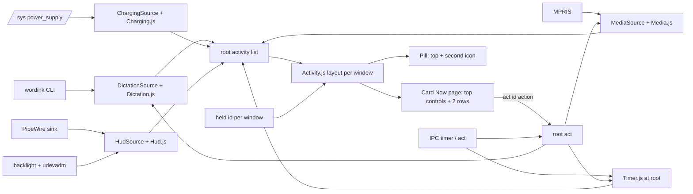
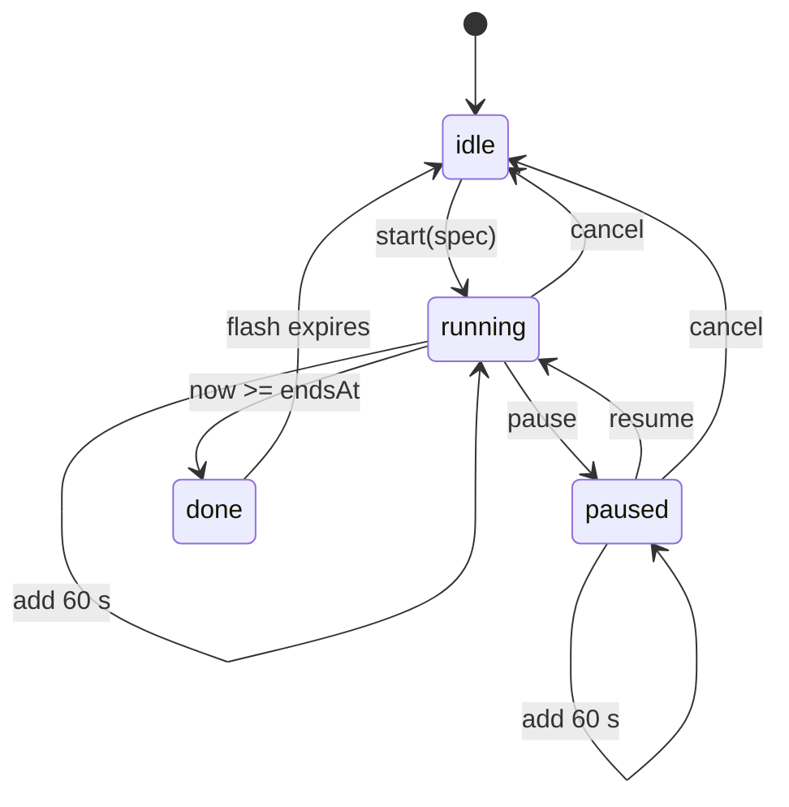

# Island Live Activities - Plan

## Goal Capsule

- **Objective:** While something is happening (a dictation, music, a timer, the charger going in, a volume or brightness key), the Island's pill shows it at a glance and its card offers the one or two controls that matter, without breaking P1's hover contract or clutter budget.
- **Means:** One pure activity model (`Activity.js`, KTD1) fed by five small sources, each with its own pure, node-tested logic module and a thin QML adapter (KTD2), rendered by the existing pill and card.
- **Authority:** P1's requirements and Key Decisions (origin) win on product behavior; this plan's Requirements refine them for P2; KTDs win on mechanism; units override neither.
- **Stop conditions:** Stop if the shipped Island code would need to write `bar.layout`, another plugin's `shell.json` entry, or `disabledPlugins` (the U6/U8 live check alone may toggle `omarchy.osd` through Omarchy's own plugin toggle and must restore it exactly as found). Stop if a source can only work by running a daemon or changing a system service. Stop if the HUD would ever show while `omarchy.osd` is enabled.
- **Execution profile:** Quickshell 0.3.2 QML plus ES5 logic modules tested with node through pytest; live checks on omarchy-max (eDP-1 only at present), Omarchy 4.5, Hyprland 0.57.2.
- **Who finishes:** One PR, `feat/island-p2`, stacked on P1's PR #74 (`feat/island-final`); it is retargeted to `main` before #74 merges.

---

## Product Contract

### Summary

P2 adds five live activities to the Island: dictation (WordInk), media (MPRIS), an Island-owned timer, a brief charging notice, and an opt-in volume/brightness HUD. Each feeds one activity list; the pill shows the top one in the right ear and a second as an icon; the card's Now page shows the top activity's controls and up to two more rows. A settings toggle per integration and an IPC surface for timers and activity actions complete it.

### Problem Frame

P1 shipped the pill and the hover contract with an empty activity area (origin: P1 Summary, Deferred P2 row). The archived notch had these activities but carried the clutter and stuck-open defects P1 removed, so each activity is rebuilt fresh against P1's activity contract and clutter budget rather than ported.

### Key Decisions

- **Fresh build; the archive is reference only.** (session-settled: user-directed — chosen over porting the archived notch's activity code: that code carried the hover defect and the clutter.) Governs R1.
- **Hover opens, leaving closes, through `Hover.js`.** (session-settled: user-directed — chosen over click-to-pin: click-to-pin left panels stuck open.) Governs R10.
- **The Island owns the bar's top center and never edits the bar or other plugins.** (session-settled: user-approved — chosen over a bar-slimming script: uninstalling the notch left widgets missing.) Governs R12.
- **Hard clutter budget.** (session-settled: user-approved — chosen over a full tab dashboard: the 15-tab strip was the clutter.) Governs R2, R3, R4.
- **Notifications stay with Omarchy until P5; the HUD is opt-in only.** (session-settled: user-approved — chosen over always claiming the OSD: only one owner can exist.) Governs R9.

### Requirements

**Activity model**

- R1. Every activity follows the origin activity contract `{ id, active, priority, text, glyph }`; logic modules are new files, never copied from `archive/`.
- R2. The pill's right ear shows the top activity (glyph plus short text, elided to the ear); with no activity it shows the date, as in P1.
- R3. A second active activity shows as one icon only in the compact pill; a third or later never shows in the compact pill.
- R4. The card's Now page shows the top activity's controls, then up to two more activity rows, inside the fixed card size; with no activity it shows P1's clock and date.
- R5. While the card is shown, the activity whose controls are on screen stays in place by id; a reorder or a new higher-priority activity never moves a control under the pointer.

**Activities**

- R6. Dictation (priority 90) is active while WordInk records or transcribes; it shows elapsed recording time or that it is transcribing, and its control is Stop.
- R7. Media (priority 50) is active while an MPRIS player plays, and for 10 minutes after it pauses; the card shows art, title and artist, a scrub bar, and previous, play/pause and next.
- R8. The timer (priority 70) is the Island's own: started by IPC with a duration, it counts down in the ear, its controls are pause/resume, +1 min and cancel, and on reaching zero it shows "Timer done" briefly and sends one desktop notification.
- R9. The volume/brightness HUD (priority 80) shows a brief level for a changed output volume, mute or internal-backlight value, and only when the Island's HUD setting is on and `omarchy.osd` is in `disabledPlugins`.
- R13. Charging (priority 30) shows briefly when the battery starts charging: percent, plus time to full when the kernel reports it.

**Boundaries**

- R10. Activity controls are ordinary card controls: using one never closes the card, and a scrub drag holds the card open (origin R7, R10).
- R11. Each integration (dictation, media, charging, HUD) has a toggle in the Island's own settings entry; a missing tool or file hides the activity with no error (origin R18).
- R12. The shipped Island code writes nothing outside the Island's own `shell.json` entry and never edits `disabledPlugins` (origin R21).
- R14. Each activity's action is also reachable by IPC, so a keybinding or agent can do what a click does.

R-IDs are plan-local; "origin R…" cites `docs/plans/2026-11-14-feat-island-plan.md`.

### Acceptance Examples

- AE1. Covers R2, R3, R5. **Given** music is playing and the card is open on the media controls, **when** a dictation starts, **then** the media controls stay where they are and dictation appears as a row; **when** the card closes, **then** the right ear shows dictation and the compact pill shows a media icon.
- AE2. Covers R6. **Given** a dictation is recording, **when** the owner presses Stop in the card, **then** WordInk stops and transcribes, the activity shows "Transcribing", then disappears.
- AE3. Covers R8. **Given** a 2-minute timer started by IPC, **when** the owner presses +1 min, **then** the remaining time grows by 60 s; **when** it reaches zero, **then** "Timer done" shows briefly and one notification is sent.
- AE4. Covers R9. **Given** `omarchy.osd` is enabled, **when** the volume changes, **then** the Island shows nothing; **given** it is disabled and the HUD setting is on, **then** the ear shows the new level for about 1.6 s.
- AE5. Covers R13. **Given** the shell starts with the charger already in, **then** no charging notice shows; **when** the charger is unplugged and plugged back in, **then** the notice shows once.

### Success Criteria

- Every activity's logic module passes its node tests (origin Deferred P2 row).
- Live on omarchy-max: with music playing from a local file, the ear shows the track and the card controls pause and resume it; a WordInk dictation shows in the ear and the Stop path ends it.

### Scope Boundaries

- Notification hosting (P5), the Media page and source switcher (P3), and P4 activities (herdr, Blip, snapdex, Dayflow).
- Writing volume or brightness: the HUD only reads.
- Claiming the `osd` IPC target: considered and not built, because shadowing a first-party target name breaks the moment the owner re-enables `omarchy.osd`; evidence of a supported takeover hook would change this.
- Remote album art (http/https URLs): considered and not built in P2, because loading it is new network egress the data-lifecycle policy does not cover; see Open Questions.
- Persisting the timer across a shell restart: considered and not built; a restart is rare and the loss is visible, so a state file and its lifecycle entry are not worth it yet.
- Starting a timer from the card: the Now page's layout beyond activities is P3; P2 starts timers by IPC and keybinding.

#### Deferred to Follow-Up Work

| Phase | Outcome |
|---|---|
| P3 | Media page with source switcher; timer quick-start chips on the Now page |
| P4 | herdr, Blip, snapdex and Dayflow activities on the same model |
| P5 | Notification host |

### Open Questions

- Remote album art (deferred, non-blocking): Spotify and browsers publish `https://` art URLs. Allowing them means the shell fetches from the player's art host; it needs Luke's yes and a `docs/data-lifecycle.json` entry. Until then those players show a glyph.

---

## Planning Contract

### Key Technical Decisions

- KTD1. **One pure activity model, `Activity.js`.** It takes the activity list, the window's held id order (KTD3) and whether the card is shown, and returns `{ top, second, rows, held }`: with the card closed, `top` is the highest priority with ties to the earlier entry and `second` and `rows` follow by priority; with the card shown, held ids keep their slots and free slots fill by priority. Rows are capped at 2. Brief activities carry an expiry time and the model drops them once `now` passes it. Instantiates R1–R5.
- KTD2. **Each source is a pure module plus a thin adapter.** `Dictation.js`, `Media.js`, `Timer.js`, `Charging.js` and `Hud.js` hold parsing, transitions and display text as ES5 with no Qt types; `*Source.qml` adapters only collect inputs (process output, MPRIS objects, sysfs reads) and run the timers the module asks for. This is P1's `Hover.js` pattern and keeps every rule node-testable. Instantiates R1, R6–R9, R13.
- KTD3. **Sources live once at the root; on-screen order is held per window.** The root owns the five sources and one activity list. While its card is shown, each `IslandWindow` holds the ordered ids it is showing (top, then rows): a held id keeps its slot while it stays live, a newly live activity only fills a free slot (or shows in the ear alone when none is free), and an id leaves only when it goes inactive. The hold is cleared when the card closes, so two screens never fight over a control. Instantiates R5.
- KTD4. **Dictation follows WordInk's own CLI events.** The adapter polls `wordink status --json` every 5 s only while no event follow runs, and follows `wordink logs -f -n 0` NDJSON `state` events otherwise, the same pattern as `plugins/io.github.duketopceo.wordink/Panel.qml`. Stop runs `wordink dictation stop`, which transcribes and pastes into the focused surface like the shortcut. Activity controls never raise the card's keyboard focus, and if the card already holds focus, Stop first sends `Hover.js` a new `unfocus` event (clears `focused`, keeps the card open) so the paste does not land in the Island. Exit 127 hides the activity (not installed); exit 3 means not running. Instantiates R6.
- KTD5. **Media reads `Quickshell.Services.Mpris` directly.** The player choice is pure: a playing player first, then the most recently paused one inside its 10-minute window, held by `dbusName` across refreshes. Position is ticked once a second only while the card is shown and the player plays, because Quickshell does not emit position changes by itself. Art loads only from `file:` and `data:` URLs (see Scope Boundaries). Instantiates R7.
- KTD6. **The timer keeps an end time, not a countdown.** `Timer.js` stores `endsAt` while running and `remainingMs` while paused; display and done-detection derive from `Date.now()`, so a stalled UI thread never drifts the timer. One QML `Timer` fires at the next whole second while a timer is visible. Done sends one notification through `/usr/bin/notify-send` when present, which uses Omarchy's notification service rather than replacing it (origin R19). Instantiates R8.
- KTD7. **Charging reads sysfs; the probe names the battery.** `bin/island-probe` adds the `power_supply` entries of type `Battery`, the `/sys/class/backlight` device names, and `notify-send` to its tool list (existence only, origin R20). The adapter re-reads `status`, `capacity` and `time_to_full_now` every 5 s with `FileView`; the first reading is the baseline. Instantiates R13.
- KTD8. **The HUD reads PipeWire and the backlight, and runs only when effective.** Effective means the `hud` setting is on and `omarchy.osd` is in `disabledPlugins`, both read from the `shell.json` text the root already watches. Volume comes from `Quickshell.Services.Pipewire`'s default sink, tracked with a `PwObjectTracker`. Brightness re-reads the backlight's `brightness` and `max_brightness` on each `udevadm monitor --subsystem-match=backlight` change line; if U6 shows no events arrive for key presses on this host, the fallback is a 500 ms re-read while the HUD is effective. The first value of each is a baseline. Instantiates R9.
- KTD9. **The Now page hosts the activity block; other pages replace it.** The card keeps its one fixed size (origin R16). P1's reserved 56 px activity area is removed: on the Now page the top activity's block takes one fixed height sized for the media layout (art, two text lines, scrub bar, transport row), each further row takes one `controlHeight`, and the clock and date show only when no activity is live. The Settings page uses the whole page area, because the block plus six settings controls cannot fit in the fixed card. Instantiates R4.
- KTD10. **The ear shows a short form; the second icon sits at the right ear's outer edge.** The ears are 56 px logical on this host, so each activity's contract `text` is its ear form of at most 5 characters (`0:12`, `…` while transcribing, `4:59`, `Done`, `46%`, `Mute`, `62%`; media uses its title, elided), and longer strings live only in the card's own fields. Alone, the top activity shows glyph plus `text`; with a second activity, the second's 16 px icon takes the right ear's outer edge and the top shows `text` without its glyph. The left ear stays the time. Instantiates R2, R3.
- KTD11. **Actions go through one root function, reached by clicks and IPC.** `act(id, action)` dispatches `stop`, `toggle`, `previous`, `next`, `seek`, `pause`, `resume`, `add`, `cancel`; IPC adds `act`, `timer(spec)` and an `activities` key in `state()`. The live check uses IPC because no click injector runs on this host (`ydotoold` is disabled). Instantiates R14.
- KTD12. **Settings gain four booleans.** `dictation`, `media`, `charging` and `hud`, all default `true`, resolved and merged by `Settings.js` like P1's delays; a non-boolean value falls back to the default. The Settings page shows them as toggles, with a one-line note under HUD when `omarchy.osd` is still enabled. Instantiates R11, R12.

### High-Level Technical Design

**Data flow.**



**Timer lifecycle.**



**Brief activities (charging, HUD).** The first reading sets a baseline and shows nothing; a later reading that differs in the watched field sets `until = now + duration` (charging 6 s on a change into `Charging`; HUD 1.6 s on any volume, mute or brightness change); the activity is active while `now < until`.

### Output Structure

```text
plugins/io.github.duketopceo.island/
  Activity.js        Dictation.js     Media.js
  Timer.js           Charging.js      Hud.js
  DictationSource.qml  MediaSource.qml  ChargingSource.qml  HudSource.qml
  ActivityBlock.qml  ActivityRow.qml
  Island.qml  IslandWindow.qml  Pill.qml  Card.qml  SettingsPage.qml  Settings.js  (modified)
  bin/island-probe   (modified)
tests/
  test_island_activity.py  test_island_dictation.py  test_island_media.py
  test_island_timer.py     test_island_charging.py   test_island_hud.py
  test_island_settings.py  test_island_probe.py  (extended)
  fixtures/island/root/sys/... (battery and backlight fixtures)
```

### Assumptions

- Media stays active for 10 minutes after a pause, so a paused track can be resumed from the card but does not hide the date all day.
- WordInk's `logs -f` emits `{"kind":"state","state":...}` lines with `listening`/`dictating` for recording and `transcribing`/`stopping` for transcribing, as `plugins/io.github.duketopceo.wordink/Panel.qml` already relies on.
- `time_to_full_now` is in seconds (kernel power-supply ABI); a zero or missing value omits the time.
- The HUD covers output volume, mute and the internal backlight only; disabling `omarchy.osd` also drops its mic-mute, keyboard-brightness and media OSDs, which the README states.
- Timer durations accept `90s`, `5m`, `1h30m` or a bare number of minutes, capped at 24 h.

### Risks & Dependencies

| Risk | Mitigation |
|---|---|
| Island Stop pastes the transcript into whatever window has focus | Same behavior as the WordInk shortcut; the live check focuses a scratch window first |
| Backlight writes emit no udev event on this host | U6 checks it live; KTD8's 500 ms fallback runs only while the HUD is effective |
| `updateEntryInline` reloads the plugin and loses a running timer | KTD6 keeps the timer in memory by choice; U7's live check records whether a settings save resets it |
| mpv publishes no MPRIS without its plugin | `/etc/mpv/scripts/mpris.so` is installed on this host; the live check confirms a player appears |
| A dictation started for the live check records ambient sound | Stop runs within seconds in a scratch window; nothing is pasted elsewhere |

---

## Implementation Units

### U1. Activity model

- **Goal:** `Activity.js` turns the activity list, a held id and the card state into what the pill and card draw.
- **Requirements:** R1–R5; KTD1.
- **Dependencies:** none.
- **Files:** `plugins/io.github.duketopceo.island/Activity.js`, `tests/test_island_activity.py`.
- **Approach:**
  1. `layout(list, held, cardShown, now)` returns `{ top, second, rows, held }` per KTD1 and KTD3; the window stores the returned `held` while its card is shown and passes `[]` once it closes.
  2. `isLive(a, now)` applies the contract (active, non-empty text, unexpired `until`).
- **Patterns to follow:** `plugins/io.github.duketopceo.island/Hover.js` and `tests/test_island_hover.py` (pure ES5 plus node-driven pytest).
- **Test scenarios:**
  - Highest priority wins; equal priority goes to the earlier entry.
  - Inactive, empty-text and expired activities are skipped.
  - Covers AE1. Card shown with held id "media", dictation becomes active: `top` stays media, dictation is in `rows`.
  - Card closed with the same inputs: `top` is dictation, `second` is media.
  - Held id no longer active while the card is shown: it leaves and the freed slot fills by priority.
  - Card shown with nothing live, then media appears, then dictation: media stays `top`, dictation takes the first row.
  - Card shown with held `[media, timer]`, then dictation appears: rows become `[timer, dictation]` (timer keeps its row).
  - Card shown with top and two rows held, a fourth activity appears: no slot changes; it is not in `rows`.
  - Four live activities with the card closed: `rows` holds at most 2, `second` is the next after `top`.
  - Empty or non-array input: all three are null or empty, no exception.
- **Verification:** All scenarios pass under node; the module loads from QML and node.

### U2. Dictation activity

- **Goal:** WordInk's recording and transcribing state becomes the dictation activity with a working Stop.
- **Requirements:** R6, R11, R14; KTD2, KTD4.
- **Dependencies:** U1.
- **Files:** `plugins/io.github.duketopceo.island/Dictation.js`, `plugins/io.github.duketopceo.island/DictationSource.qml`, `plugins/io.github.duketopceo.island/Hover.js` (`unfocus` event), `tests/test_island_dictation.py`, `tests/test_island_hover.py`.
- **Approach:**
  1. `Dictation.js`: `fromStatus(json)` and `fromEvent(line)` map to `idle | recording | transcribing | off`; `step(model, state, now)` records when recording began; `activity(model, now)` gives the contract object with ear text `0:12` or `…` and card text `Recording 0:12` or `Transcribing`.
  2. `DictationSource.qml` runs the status poll and log follow per KTD4, gated by the `dictation` setting and the probe's `tools.wordink`, and exposes `stop()`.
  3. `Hover.js` gains `unfocus` per KTD4.
- **Patterns to follow:** `plugins/io.github.duketopceo.wordink/Panel.qml` (status/follow/exit codes, bounded output).
- **Test scenarios:**
  - Status JSON with `capture.state` `recording` → recording; `transcribing` → transcribing; `idle` → idle.
  - Event lines `listening` and `dictating` → recording; `stopping` → transcribing; `sleeping` → idle.
  - Malformed, oversized (> 4000 chars) and non-state lines → no change.
  - Recording for 12 s → text `0:12`; 75 s → `1:15`; transcribing → text `…`.
  - Recording → transcribing keeps the activity; → idle drops it.
  - Off (not installed or not running) → inactive.
  - Hover: `unfocus` on an open, focused card → still open, `focused` false; on a closed card → unchanged.
- **Verification:** Tests pass; live, `wordink dictation start` shows the activity within a second and IPC `act dictation stop` ends it with the transcript in the focused scratch window. Pressing Stop with the pointer needs a click injector (none runs here), so that path is a recorded manual check.

### U3. Media activity

- **Goal:** The chosen MPRIS player becomes the media activity with art, title/artist, scrub and transport controls.
- **Requirements:** R7, R10, R11, R14; KTD2, KTD5.
- **Dependencies:** U1.
- **Files:** `plugins/io.github.duketopceo.island/Media.js`, `plugins/io.github.duketopceo.island/MediaSource.qml`, `tests/test_island_media.py`.
- **Approach:**
  1. `Media.js`: `pick(players, heldName, pausedAt, now)` per KTD5; `activity(player, now)`; `artUrl(url)` returns the URL only for `file:` or `data:`; `fmt(seconds)`; `seekTarget(fraction, length)` clamps to `[0, length]`.
  2. `MediaSource.qml` maps `Mpris.players` to plain objects, remembers when each player last stopped playing, ticks position per KTD5, and exposes `toggle()`, `previous()`, `next()` and `seek(fraction)` that respect `canTogglePlaying`, `canGoPrevious`, `canGoNext` and `canSeek`.
- **Patterns to follow:** `archive/notch/plugin/Media.js` for player fields only (read, not copied).
- **Test scenarios:**
  - One playing and one paused player → the playing one.
  - None playing; one paused 3 min ago → active; paused 11 min ago → inactive.
  - Held player still present → kept even when another starts playing.
  - Text is the title, falling back to the identity when the title is empty.
  - `artUrl` keeps `file:///x.png` and `data:image/png;base64,...`, drops `https://...` and `http://...`.
  - `fmt(0)` → `0:00`, `fmt(3725)` → `1:02:05`; `seekTarget(1.4, 200)` → 200, `seekTarget(-1, 200)` → 0.
  - No players → inactive, no exception.
- **Verification:** Tests pass; live with mpv playing a local file, the ear shows the title and IPC `act media toggle` pauses and resumes it.

### U4. Island timer

- **Goal:** A countdown timer owned by the Island, started by IPC, with pause/resume, +1 min, cancel and a done notice.
- **Requirements:** R8, R14; KTD6, KTD11.
- **Dependencies:** U1, U5 (probe's `notify-send` entry).
- **Files:** `plugins/io.github.duketopceo.island/Timer.js`, `plugins/io.github.duketopceo.island/Island.qml`, `tests/test_island_timer.py`.
- **Approach:**
  1. `Timer.js`: `parse(spec)`, `start`, `pause`, `resume`, `add`, `cancel`, `tick(model, now)` (moves running to done), `activity(model, now)` and `nextTickMs(model, now)`, per the HTD timer lifecycle. The done flash lasts 8 s with ear text `Done` and card text `Timer done`.
  2. The root holds the timer model and one QML `Timer` re-armed to `nextTickMs`; on the transition into done it runs `/usr/bin/notify-send` once when the probe's `tools["notify-send"]` is true.
- **Test scenarios:**
  - `parse`: `90s` → 90 000; `5m` → 300 000; `1h30m` → 5 400 000; `10` → 600 000; `0`, `abc`, `-5m` and `25h` → rejected.
  - Covers AE3. Start 2 min, add → remaining 3 min; pause at 1:30 left, wait 10 s → still 1:30; resume → counts down again.
  - `tick` at or after `endsAt` → done with a flash `until`; after `until` → idle.
  - Cancel from running or paused → idle; cancel when idle → unchanged.
  - Text: `4:59` under an hour, `1:02:05` above; paused shows the frozen time.
- **Verification:** Tests pass; live, `qs ipc call island timer 1m` shows the countdown, `act timer add` moves it, and at zero one notification arrives.

### U5. Charging activity and probe additions

- **Goal:** A brief notice when the battery starts charging, with the probe reporting which batteries and backlights exist.
- **Requirements:** R11, R13; KTD2, KTD7.
- **Dependencies:** U1.
- **Files:** `plugins/io.github.duketopceo.island/Charging.js`, `plugins/io.github.duketopceo.island/ChargingSource.qml`, `plugins/io.github.duketopceo.island/bin/island-probe`, `tests/test_island_charging.py`, `tests/test_island_probe.py`, `tests/fixtures/island/root/sys/class/power_supply/`, `tests/fixtures/island/root/sys/class/backlight/`.
- **Approach:**
  1. The probe adds `power: { batteries: [...], backlights: [...] }` by listing `sys/class/power_supply/*/type == Battery` and `sys/class/backlight/*` under its root, and adds `notify-send` to its tool list.
  2. `Charging.js`: `parse({status, capacity, timeToFull})`, `step(model, reading, now)` per the HTD brief-activity rule, `activity(model, now)` with text `62%` and card text `62% · 1h 12m to full`.
  3. `ChargingSource.qml` re-reads the first battery's three files every 5 s while the `charging` setting is on.
- **Patterns to follow:** `plugins/lukedaduke.power/Model.js` with `tests/test_power_model.py`.
- **Test scenarios:**
  - Covers AE5. First reading `Charging` → baseline, inactive.
  - `Discharging` then `Charging` → active for 6 s; `Not charging` then `Charging` → active.
  - `Charging` then `Charging` → no new notice.
  - `time_to_full_now` 4320 → `1h 12m to full`; 0 or missing → percent only.
  - Garbage capacity → reading ignored.
  - Probe: fixture root with a `Battery` and a `Mains` supply → only the battery listed; a backlight dir → listed; no `sys` tree → empty lists; `notify-send` in the fixture `bin` → `tools["notify-send"]` true.
- **Verification:** Tests pass; live, the probe on this host lists `macsmc-battery` and `apple-panel-bl`.

### U6. Opt-in volume/brightness HUD

- **Goal:** A brief level in the ear for volume, mute and backlight changes, only when the owner has disabled `omarchy.osd` and kept the HUD setting on.
- **Requirements:** R9, R11, R12; KTD2, KTD8, KTD12.
- **Dependencies:** U1, U5 (backlight name from the probe), U7 (settings keys).
- **Files:** `plugins/io.github.duketopceo.island/Hud.js`, `plugins/io.github.duketopceo.island/HudSource.qml`, `tests/test_island_hud.py`.
- **Approach:**
  1. `Hud.js`: `effective(settings, shellJson)`, `step(model, {kind, value, muted}, now)` with a per-kind baseline, `activity(model, now)` with ear text `46%` or `Mute`, card text `Volume 46%`, `Muted` or `Brightness 25%`, and a `level` field for the card's bar.
  2. `HudSource.qml` binds PipeWire's default sink and the backlight per KTD8, all inside a `Loader` that is active only while effective, so nothing runs otherwise.
- **Execution note:** Check live early whether `brightnessctl set` produces a `udevadm monitor` line for `apple-panel-bl`; that picks KTD8's branch before the adapter is written.
- **Test scenarios:**
  - Covers AE4. `omarchy.osd` not in `disabledPlugins` → not effective; in it with `hud` true → effective; `hud` false → not effective; malformed shell JSON → not effective.
  - First volume reading → baseline, inactive; a second, different reading → active for 1.6 s with text `46%`.
  - Mute toggled with the same volume → active with ear text `Mute`.
  - Brightness 125/500 after a baseline of 100/500 → `25%`.
  - Same value repeated → no new flash; volume above 100% → text shows the real value, level clamps to 1.
- **Verification:** Tests pass; live, with the HUD effective a `wpctl set-volume` change shows the level and with `omarchy.osd` enabled nothing shows. The live check restores the owner's `disabledPlugins` exactly as found.

### U7. Rendering, wiring, settings and IPC

- **Goal:** The pill and card draw the activity layout, controls call the root's `act`, settings gain the four toggles, and IPC exposes timers, actions and activities.
- **Requirements:** R2–R5, R10–R12, R14; KTD3, KTD4, KTD9, KTD10, KTD11, KTD12.
- **Dependencies:** U1–U5 (U6 plugs in through the same list).
- **Files:**
  - `plugins/io.github.duketopceo.island/Island.qml`, `plugins/io.github.duketopceo.island/IslandWindow.qml`
  - `plugins/io.github.duketopceo.island/Pill.qml`, `plugins/io.github.duketopceo.island/Card.qml`
  - `plugins/io.github.duketopceo.island/ActivityBlock.qml`, `plugins/io.github.duketopceo.island/ActivityRow.qml`
  - `plugins/io.github.duketopceo.island/SettingsPage.qml`, `plugins/io.github.duketopceo.island/Settings.js`
  - `tests/test_island_settings.py`, `tests/test_island_activity.py`
- **Approach:**
  1. The root instantiates the sources, builds the activity list, and implements `act` and the IPC functions per KTD11.
  2. Each window keeps its held order per KTD3 and computes `Activity.layout`.
  3. `Pill` draws `top` and `second` per KTD10, falling back to P1's date.
  4. `ActivityBlock` draws the top activity's controls and `ActivityRow` a one-line row with its primary control, per the table below; the Now page lays them out per KTD9, replacing P1's reserved activity area.
  5. The scrub bar sends `holdStart`/`holdEnd` on drag (R10); buttons call `act`, never close the card and never raise keyboard focus (KTD4). A control whose capability is false (`canSeek`, `canGoNext`, `canGoPrevious`) draws at reduced opacity and ignores clicks; with no seek or a zero length the scrub bar is hidden.
  6. `Settings.js` and `SettingsPage` gain the KTD12 toggles.

  | Activity / state | Glyph | Row primary control | Block |
  |---|---|---|---|
  | Dictation recording / transcribing | mic / hourglass | Stop (recording only) | card text, Stop |
  | Media playing / paused | play / pause | play-pause | art (music glyph when none), title, artist, scrub, previous, play-pause, next |
  | Timer running / paused / done | timer / timer-pause / check | pause-resume (none when done) | time, pause-resume, +1 min, cancel |
  | Charging | bolt | none | card text |
  | HUD volume / mute / brightness | volume / volume-off / brightness | none | card text, level bar |
- **Patterns to follow:** P1's `Card.qml` chips and `SettingsPage.qml` (`qs.Ui` controls, plain-text `Text`, `Commons.Color` tokens); `/usr/share/omarchy/shell/plugins/osd/Osd.qml` for the level bar's look.
- **Test scenarios:**
  - Settings: no entry → the four toggles default true; `"media": "no"` → true; merging `{ hud: false }` keeps the delays and the id.
  - Integration (live): pill shows the music title, then dictation with a media icon at the outer edge (AE1).
  - Integration (live): with the card open on media, starting a dictation leaves the media controls in place.
  - Integration (live): screenshot of the Now page with three live activities shows the block and two rows unclipped inside the card.
  - Integration (live): `qs ipc call island state` includes `activities` with ids and priorities.
  - Every new `Text` uses plain text and every color a `Commons.Color` token (contract checker).
- **Verification:** `check-qml-syntax.py` and the contract checker pass; the shell log shows no Island errors after a reload; screenshots show the pill and card with an activity.

### U8. Live check, docs and gates

- **Goal:** Prove P2 on this machine, document it, and pass every repo gate.
- **Requirements:** Success Criteria; R9, R12.
- **Dependencies:** U1–U7.
- **Files:** `plugins/io.github.duketopceo.island/README.md`, `docs/reviews/io.github.duketopceo.island.md`, `plugins/io.github.duketopceo.island/manifest.json` (version bump), `catalog.json` (version).
- **Approach:**
  1. Point the live plugin link at this worktree, confirm the screen is unlocked, and run: mpv on a local file (ear, IPC toggle, card screenshot), a dictation in a scratch window (ear, IPC stop), a 1 m timer (+1 min, cancel, and one run to done), and the HUD with `omarchy.osd` disabled then restored.
  2. Re-run P1's `bin/island-hover-check --runs 5 --mode both` with an activity live, to show P2 did not break hover.
  3. Record results in the review doc; README gains the activities, the timer IPC and an example keybinding line for the owner to add, the HUD opt-in steps and what disabling `omarchy.osd` drops.
- **Test expectation:** none -- live-only verification and docs; results are recorded in the review doc.
- **Verification:** Every live step above is recorded with its result or the reason it was skipped; the full gate list passes locally.

---

## Verification Contract

| Gate | Command | Applies to |
|---|---|---|
| Tests | `python -m pytest tests/ -q` with `node` installed | U1–U7 |
| Manifests | `python scripts/validate-manifests.py` | U8 |
| Plugin contract | `python scripts/check-plugin-contract.py` | U2–U7 |
| Release readiness | `python scripts/check-release-readiness.py` | U8 |
| Scorecard | `python scripts/check-scorecard.py` | U8 |
| Data lifecycle | `python scripts/check-data-lifecycle.py` | every PR |
| QML syntax | `REQUIRE_QMLLINT=1 python scripts/check-qml-syntax.py` | U2–U7 |
| Lint | `ruff check --select E9,F63,F7,F82 scripts shared tests plugins`; `shellcheck --severity=error` on shell helpers | U5, U8 |
| Live | the U8 steps on omarchy-max | U8 |

A failure that also fails on `feat/island-final` is reported, not fixed, here.

## Definition of Done

- U1–U8 land in one PR based on `feat/island-final`, with every Verification Contract gate passing.
- Each activity's logic module has passing node tests.
- The U8 live steps are recorded in the review doc, each as passed or skipped with its reason.
- `shell.json` differs only in the Island's own entry after the live run, and `disabledPlugins` is exactly as found.
- No probe scaffolding, abandoned experiments or archived code are left in the diff.

## Appendix

### Sources

- Activity contract, priorities and P2 scope: `docs/plans/2026-11-14-feat-island-plan.md` (Feature Catalog, Deferred P2 row).
- P1 live decisions (Overlay layer, `OnDemand` focus without a grab, pointer moves via `hyprctl dispatch`): `docs/reviews/io.github.duketopceo.island.md`.
- WordInk CLI contract: `wordink --help`, `wordink dictation --help` (exit 3 = not running); `plugins/io.github.duketopceo.wordink/Panel.qml`.
- OSD ownership: `/usr/share/omarchy/shell/plugins/osd/Osd.qml` (`ShellIpc` target `osd`), `/usr/share/omarchy/bin/omarchy-osd`.
- Quickshell services on this host: `Quickshell.Services.Mpris` (`trackArtUrl`, `position`, `canSeek`, `togglePlaying`), `Quickshell.Services.Pipewire` (`defaultAudioSink.audio.volume`/`muted`, `PwObjectTracker`), from the installed 0.3.2 qmltypes.
- Host facts: `/sys/class/power_supply/macsmc-battery`, `/sys/class/backlight/apple-panel-bl`, `/etc/mpv/scripts/mpris.so`, `/usr/bin/notify-send`.
