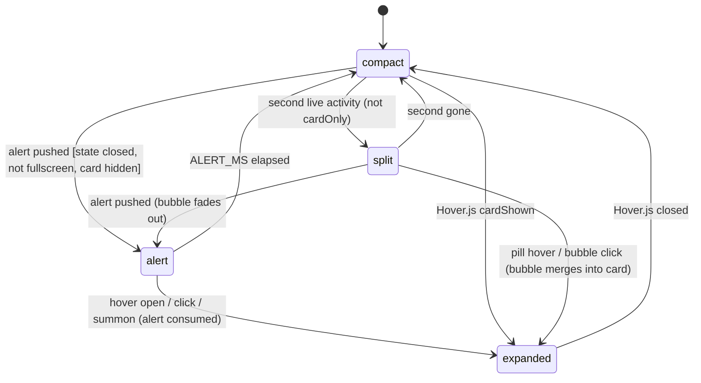
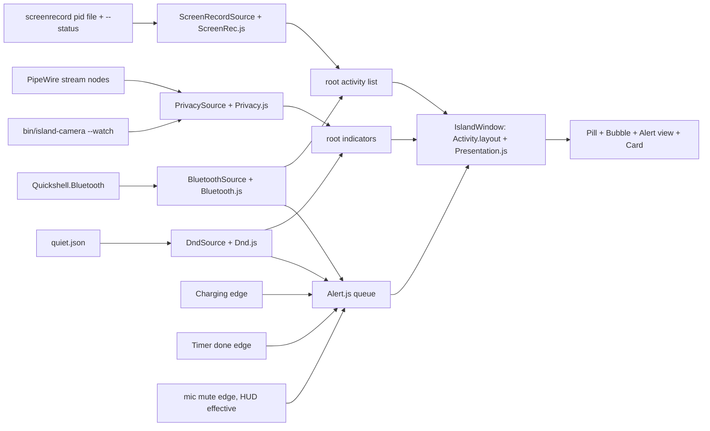

# Island Mac Parity - Plan

## Goal Capsule

- **Objective:** On Luke's MacBook the Island reads and moves like Apple's Dynamic Island: a black pill that merges with the camera cutout, a springy morph that grows to fit what it shows, a split bubble for a second activity, short alert expansions for system events, and the system states Apple surfaces there (screen recording, mic and camera in use, Do Not Disturb, Bluetooth audio), without breaking P1's hover contract or clutter budget.
- **Means:** Pure, node-tested ES5 modules for every new rule (presentation, alerts, screen recording, privacy, DND, Bluetooth, tint), thin QML adapters that read Omarchy's own commands, files and Quickshell services, and the existing root/window split (KTD1, KTD2).
- **Authority:** P1's requirements and Key Decisions (origin) win on product behavior; this plan's Requirements refine them; KTDs win on mechanism; units override neither.
- **Stop conditions:** Stop if any unit needs to write `bar.layout`, another plugin's `shell.json` entry, or `disabledPlugins`. Stop if a source needs a daemon, a system service change, a privileged container or a VM. Stop if the mask would have to follow an animating shape to make a feature work.
- **Execution profile:** Quickshell 0.3.2 QML plus ES5 modules tested with node through pytest; live checks on omarchy-max (eDP-1 3456x2234 at scale 2; DP-3 when connected), Omarchy 4.5, Hyprland 0.57.2.
- **Who finishes:** One PR, `feat/island-mac-parity`, off `main` (f5665d0); version 0.3.0.

---

## Product Contract

### Summary

Nine changes bring the Island to Apple parity, optimized for Omarchy: black compact surface on notch screens, spring morph and content-sized pill, split-bubble presentation, transient alerts, and five system activities or indicators (screen recording, mic/camera privacy dots, DND, Bluetooth audio, Now Playing polish), plus three small fixes in code this work touches. Every new source has a settings toggle (default on) and hides itself when its backend is missing.

### Problem Frame

P1 and P2 shipped the hover contract and five activities, but the pill is drawn in theme colors (a dark grey slab around a black camera cutout), morphs with a flat ease, crams a second activity into the ear as a 16 px icon, and has no way to say "the charger just went in" except a 6 s ear label. Apple's island is also the place where the system says it is recording, listening or watching; the Island shows none of that, so the owner keeps glancing at the bar for those states.

### Key Decisions

- **The Island never edits the bar layout or other plugins' entries.** (session-settled: user-approved, origin — chosen over a bar-slimming script: uninstalling the notch left widgets missing.) Governs R18.
- **Hard clutter budget: at most two activities in compact.** (session-settled: user-approved, origin — chosen over a dashboard: the 15-tab strip was the clutter.) Governs R3, R9.
- **The OSD stays with Omarchy unless the owner opts in.** (session-settled: user-approved, origin P2 — chosen over always claiming it.) Governs R6.
- **Remote album art stays a glyph.** (session-settled: user-directed — chosen over fetching `https://` art: new network egress needs Luke's yes.) Governs R15.

### Requirements

**Presentation**

- R1. On a screen with a matched camera cutout, the compact pill (and the split bubble) is pure black so it merges with the cutout; text and accents stay theme colors; the expanded card and alerts use theme colors on every screen; notchless screens keep the theme-colored virtual pill.
- R2. Compact to expanded and back is a spring (slight overshoot on open, faster settle on close); the pill's width animates to its content; with reduced motion on, both snap. The input mask changes only at commit points (origin KTD2/KTD3), never per animation frame.
- R3. With two live activities the second shows as a detached circular minimal bubble beside the pill, not in the ear; a third never shows in compact. Clicking the bubble opens the card with that activity on top.
- R4. A transient alert expands the island for about 3 s, then collapses, for: charger connected (battery ring and percent), timer finished, Bluetooth audio connected (name and battery), DND turned on or off, and mic mute toggled.
- R5. An alert never takes keyboard focus, never shows on a screen with a real fullscreen window (dropped, not queued), never shows while that screen's card is shown, and yields when the pointer enters (normal hover rules apply).
- R6. The mic-mute alert shows only when the Island's HUD is effective (origin P2: `hud` on and `omarchy.osd` in `disabledPlugins`), because Omarchy's OSD already shows mic mute otherwise.

**System activities and indicators**

- R7. Screen recording (priority 88) is an activity while Omarchy's recorder runs: elapsed time in the ear, Stop in the card and rows; Stop runs Omarchy's own `omarchy-capture-screenrecording --stop-recording`.
- R8. A mic-in-use dot shows while any app captures audio, and a camera-in-use dot while any of the owner's processes holds a camera device; both sit at the pill's inner right edge beside the camera, in Apple's orange (mic) and green (camera) hues derived from the theme.
- R9. Privacy dots and the DND glyph are indicators, not activities: they do not count against R3's two-activity budget and never displace the ear content.
- R10. While Omarchy's notifications are in Do Not Disturb, a DND glyph shows in the left ear beside the time; the card has a DND toggle that runs Omarchy's own toggle command; both hide when `omarchy.notifications` is disabled.
- R11. A connected Bluetooth audio device (headphones, headset, speaker) is a card-only activity showing its name and battery; it never takes the ear or the bubble.
- R12. While media plays, the ear's media glyph is an animated equalizer (static bars with reduced motion).
- R13. When the playing track has local (`file:`/`data:`) art, the media accents (equalizer, scrub fill, emphasized control) take a color from that art that stays readable on the surface; otherwise the theme accent.

**Settings and boundaries**

- R14. Settings gain one toggle each, all default on: `screenRecording`, `privacy`, `dnd`, `bluetooth`, `alerts`; a missing backend hides its feature with no error.
- R15. No new network egress; remote art stays a glyph.
- R16. Every new action is reachable by IPC (`act screenrec stop`), and `state()` reports the alert, indicators and presentation so live checks can read them.
- R17. Fixes: no `time_to_full_now` read warning on startup while not charging; `opened` turns false when a window with its card shown is destroyed; `island-hover-check` reports a SIGALRM deadline during `state()` as exit 3, not 2.
- R18. The shipped code writes nothing outside the Island's own `shell.json` entry and never edits `disabledPlugins` (origin R21).

### Acceptance Examples

- AE1. Covers R1. **Given** eDP-1 (notch), **then** the closed pill's fill is black; **when** it opens, **then** the card fill is the theme's popup background. **Given** DP-3, **then** the closed pill uses the theme background.
- AE2. Covers R3. **Given** media playing and a timer running, **then** the ear shows the timer with its glyph and a circular bubble beside the pill shows the media glyph; **when** the owner clicks the bubble, **then** the card opens with media on top.
- AE3. Covers R4, R5. **Given** the card is closed and no fullscreen window, **when** the charger is plugged in, **then** the island expands with a battery ring and "Charging 62%" for about 3 s and collapses; **given** a fullscreen video on that screen, **then** nothing shows and nothing shows later either.
- AE4. Covers R5. **Given** an alert is showing, **when** the pointer rests on the pill, **then** the alert ends and the card opens after `openDelay`.
- AE5. Covers R7. **Given** `omarchy screenrecord` started, **then** the ear shows a red-dot glyph and `0:05`; **when** Stop is pressed (or `act screenrec stop`), **then** the recording stops through Omarchy's command and the activity clears.
- AE6. Covers R8, R9. **Given** a scratch `pw-record` capturing the mic, **then** the orange dot shows within a second; **when** it exits, **then** the dot clears; the ear content is unchanged throughout.

### Success Criteria

- Every new pure module passes its node tests, written red-first.
- Live on omarchy-max: AE1 (eDP-1), AE2 (by IPC timer plus mpv), AE3 (charging via alert preview, real plug if it happens), AE5 and AE6 pass with screenshots; the P1 hover check passes 5 runs with an activity live.

### Scope Boundaries

- Notification hosting (P5), the Media page and source switcher (P3), herdr/Blip/snapdex/Dayflow (P4).
- Pairing, connecting or changing Bluetooth devices; writing volume, brightness or mic mute.
- A persistent Bluetooth ear activity: considered and not built, because a connected headset would hide the date all day and Apple only alerts on connect; evidence the owner wants it in the ear would change this (R11).
- Click-through interactivity on the alert area outside the pill: considered and not built, because the mask would have to grow for a 3 s surface under a pointer that is usually elsewhere (KTD2 risk); hovering the pill still opens the card.
- A long-press or swipe gesture model (iPhone): no trackpad gesture source in Quickshell layer surfaces worth the complexity.

#### Deferred to Follow-Up Work

| Phase | Outcome |
|---|---|
| P3 | Media page; DND schedule; timer quick-start chips |
| Later | Remote album art behind an owner opt-in plus a `docs/data-lifecycle.json` entry |

---

## Planning Contract

### Key Technical Decisions

- KTD1. **New rules live in pure ES5 modules with node tests; QML adapters only collect inputs.** New modules: `Presentation.js` (surface, widths, bubble and zone rects), `Alert.js` (queue and gating), `ScreenRec.js`, `Privacy.js`, `Dnd.js`, `Bluetooth.js`, `Tint.js`. This is P1/P2's pattern (`Hover.js`, `Activity.js`) and keeps every rule red-first testable. Instantiates R1–R13.
- KTD2. **The hot zone may change only at commit points: a Hover.js state commit or a change in the compact target (content width, bubble present).** The compact target is a discrete value computed from the layout, not the animating width, so the mask still never follows a frame-by-frame shape (origin KTD2). Growth under a still pointer cannot fire a leave; a shrink under the pointer fires a real leave, which is the correct answer. The zone in compact covers the pill plus the bubble when present, each plus 6 px. Instantiates R2, R3.
- KTD3. **Spring via `Easing.OutBack` on width and height with `Commons.Style.duration()`.** `SpringAnimation` has no duration and would ignore reduced motion; `OutBack` with a small overshoot (about 1.2) on open and `Commons.Style.easeOut` on close gives Apple's overshoot-then-settle and snaps when `duration()` returns 0. This supersedes origin KTD10's no-bounce rule for growth only; shrinking keeps `easeOut`. Instantiates R2.
- KTD4. **Black compact surface is a hardware fact, not a theme color.** `Presentation.surface(hasCutout, mode)` returns `notch` for compact and split on a cutout screen and `theme` otherwise; QML maps `notch` to opaque black and `theme` to `Commons.Color.popups.background`. The border is drawn only in theme mode (a border around black would outline the cutout). On black, pill text uses the theme's popup text when its contrast against black is at least 4.5:1, else the theme background color (light on a light theme), chosen by `Presentation.textOnBlack`. Instantiates R1.
- KTD5. **The pill's ear width follows content within bounds.** QML measures the ear label with `TextMetrics`; `Presentation.compact(geom, wantEar)` clamps the ear to `[EAR_MIN 56, EAR_MAX 120]` logical px (EAR_MIN keeps the origin's 56 px ear as the floor) and the pill to the screen; the idle date and time keep the P1 width. Instantiates R2.
- KTD6. **Split bubble: diameter = compact height, gap 6 px, right of the pill, top-flush like the pill.** The bubble shows `layout.second`'s glyph; the ear then shows the top activity with its glyph again (supersedes P2 KTD10's in-ear second icon). Hovering the bubble opens the card through the normal hover rules with the normal order; only a click seeds the window's held order with the second's id before sending `click`, so `Activity.layout` puts it on top (existing held-slot behavior). Instantiates R3.
- KTD7. **Alerts are a root queue drawn per window, outside Hover.js.** `Alert.js`: `push(model, alert, now)` (same kind replaces; at most one pending), `current(model, now)`, `ALERT_MS 3000`. Each window shows the root's current alert only when `Presentation`'s gate holds: card not shown, not fullscreen, state `closed`; an alert seen while blocked is marked consumed for that window, so it never shows late (R5). The alert grows the body but never changes the mask or keyboard focus; while it shows, the bubble fades out and the alert body replaces the ear content, and when it ends the body morphs back to compact or split with the bubble fading in. Layout: glyph or level ring at left, title over detail, each one line and elided; the size is fixed (about 360 x 76, clamped to the screen) whatever the strings. Instantiates R4, R5.
- KTD8. **Alert sources reuse existing transitions.** Charging: `Charging.step` already detects the plug-in edge; the root pushes an alert on a new `until`. Timer: the existing done edge in `timerUpdate`. DND: `Dnd.js` edge after the first reading. Bluetooth: `Bluetooth.js` connect edge after the first snapshot. Mic mute: the default source's `muted` edge, only when `hudEffective` (R6). Instantiates R4, R6.
- KTD9. **Screen recording follows Omarchy's own files and commands.** Poll `$XDG_RUNTIME_DIR/omarchy-screenrecord-pid` with a `FileView` every 2 s (no process spawn); on a new pid, confirm with `omarchy-capture-screenrecording --status` (exit 0 = ours and running), and re-confirm every 15 s while recording. Elapsed time comes from `/proc/<pid>/stat` start time against `/proc/uptime` (`ScreenRec.elapsed`, USER_HZ 100), so a shell restart mid-recording still shows the true time. Stop is `omarchy-capture-screenrecording --stop-recording` run detached. The probe adds `omarchy-capture-screenrecording` to its tool list. Instantiates R7.
- KTD10. **Mic in use from PipeWire stream nodes; camera in use from a watcher helper.** Mic: `Quickshell.Services.Pipewire` nodes that are audio input streams are tracked with `PwObjectTracker`; `Privacy.micInUse(records)` counts a node only when it is not `node.passive`, not `stream.monitor`/`media.category Monitor`, and not `stream.capture.sink` (this host's always-running Asahi filter-chain capture nodes are passive). Camera: `bin/island-camera --watch` scans the owner's `/proc/*/fd` every 2 s for `/dev/video*` links whose sysfs name is not a codec (`avd` on this host), prints a JSON line only on change, and exits when its parent goes away; one process for the session instead of one spawn per poll. Instantiates R8.
- KTD11. **Privacy hues are Apple's, intensity is the theme's.** `Privacy.dotColor(kind, base)` keeps Apple's hue (orange about 30 deg, green about 130 deg) and takes saturation and lightness from `Commons.Color.urgent`, so the dots match the theme's intensity on any theme without hardcoded hex. Instantiates R8.
- KTD12. **DND reads Omarchy's quiet state and toggles through Omarchy's command.** `FileView` on `~/.local/state/omarchy/notifications/quiet.json` with `watchChanges` plus a 5 s reload backstop (the service writes atomically, which can drop a file watch); empty or missing file means off (`Dnd.parse`). The card toggle runs `omarchy-toggle-notification-silencing`, which calls `notifications toggleDnd` and refreshes the bar indicator. Hidden when `omarchy.notifications` is in `disabledPlugins`. Instantiates R10.
- KTD13. **Bluetooth through `Quickshell.Bluetooth`, loaded lazily.** A `Loader` active only while the `bluetooth` setting is on hosts the reader; `Bluetooth.audio(devices)` keeps connected devices whose icon starts with `audio-`; battery shows when `batteryAvailable`. `Activity.js` gains a `cardOnly` flag: such activities never take `top` or `second`, only card rows, so with nothing else live the card shows the clock and date with the device as a row beneath them (Card.qml renders rows while `top` is null). Read-only. Instantiates R11.
- KTD14. **Tint from Quickshell's `ColorQuantizer`, local art only.** Active only when `Media.artUrl` returned a `file:`/`data:` URL; `Tint.pick(colors, surface)` takes the most saturated color whose contrast against the surface is at least 3:1, else falls back to `Commons.Color.accent`. Instantiates R13, R15.
- KTD15. **Settings: five booleans more, same merge rules; the page uses three columns** so nine toggles and two delays fit the fixed card without scrolling (origin R16). Instantiates R14.

### High-Level Technical Design

**Presentation states per window.** Hover.js is unchanged; presentation is derived from it plus the alert and layout.

| Presentation | Body size | Surface (cutout screen) | Mask (KTD2) |
|---|---|---|---|
| compact | pill, ear width to content | black | pill + 6 |
| split | pill + detached bubble | black (both) | pill + bubble + 6 |
| alert | alert size (about 360 x 76) | theme | pill + 6 (unchanged) |
| expanded | card | theme | card + 12 |

**Data flow.**

### Assumptions

- Apple conventions taken as the target without fetching references: compact/minimal/expanded presentations, about 3 s alert expansions, green camera and orange mic dots, a black island.
- The `bluetooth` activity is card-only (inferred from "Apple alerts on connect"), see Scope Boundaries.
- The mic-mute alert follows the HUD gate (R6); with `omarchy.osd` enabled on this host today, it will not show until the owner opts in.
- Privacy dots show on every screen's pill, like activities.
- An alert shows on every visible, closed island at once (same as activities); one queue for the session.
- Screen-recording priority 88 (below dictation 90, above HUD 80).
- No click injector runs here (`ydotoold` failed), so bubble click, DND toggle and Stop by pointer are recorded manual checks; their actions are verified through the same IPC path.

### Risks & Dependencies

| Risk | Mitigation |
|---|---|
| Ear width changes under a resting pointer move the hot zone | KTD2: only discrete target changes move the mask; a shrink out from under the pointer is an accepted real leave; the ear uses tabular digits so a running timer does not change width each second; the hover check runs with a timer live |
| `OutBack` overshoot exceeds the fixed window or clips | Overshoot applies to the body inside the fixed card-sized window; the card is smaller than the window by the slop |
| Quickshell `properties` on PipeWire nodes are empty until bound | Track only stream nodes with `PwObjectTracker` (few); verify live with `pw-record` |
| The camera watcher misses a capture held by a root daemon | Only the owner's processes are readable; the relay (`v4l2-relayd`) serves a user consumer, which is what is detected |
| `Quickshell.Bluetooth` import fails without BlueZ | The import sits in a lazily loaded component; a load failure leaves the activity empty |
| The shell's PATH lacks `/usr/share/omarchy/bin` | The probe reports the tool; screen recording and the DND toggle hide when it is false |

---

## Implementation Units

| U-ID | Title | Key files | Depends on |
|---|---|---|---|
| U1 | Small fixes | `ChargingSource.qml`, `Island.qml`, `IslandWindow.qml`, `bin/island-hover-check` | none |
| U2 | Presentation model | `Presentation.js`, `Zone.js` | none |
| U3 | Black surface, spring, content width | `IslandWindow.qml`, `Pill.qml` | U2 |
| U4 | Split bubble | `Bubble.qml`, `IslandWindow.qml`, `Pill.qml` | U2, U3 |
| U5 | Alerts | `Alert.js`, `AlertView.qml`, `Island.qml`, `IslandWindow.qml` | U2, U3 |
| U6 | Screen recording | `ScreenRec.js`, `ScreenRecordSource.qml`, `bin/island-probe` | U5 |
| U7 | Privacy dots | `Privacy.js`, `PrivacySource.qml`, `bin/island-camera`, `Pill.qml` | U3 |
| U8 | DND | `Dnd.js`, `DndSource.qml`, `Pill.qml`, `Card.qml` | U5 |
| U9 | Bluetooth audio | `Bluetooth.js`, `BluetoothSource.qml`, `Activity.js` | U5 |
| U10 | Now Playing polish | `Tint.js`, `Equalizer.qml`, `Pill.qml`, `ActivityBlock.qml` | U3 |
| U11 | Settings, IPC, docs, live check | `Settings.js`, `SettingsPage.qml`, `Island.qml`, README, review doc, manifest, catalog | U1–U10 |

### U1. Small fixes

- **Goal:** The three named defects are gone (R17).
- **Requirements:** R17.
- **Dependencies:** none.
- **Files:** `plugins/io.github.duketopceo.island/ChargingSource.qml`, `plugins/io.github.duketopceo.island/Island.qml`, `plugins/io.github.duketopceo.island/IslandWindow.qml`, `plugins/io.github.duketopceo.island/bin/island-hover-check`, `tests/test_island_hover_check.py` (new).
- **Approach:**
  1. ChargingSource: the path is already gated on `charging`, so the remaining warning is a race (the blockLoading FileView loads the moment `charging` flips true, while the kernel may already report `Not charging` near this host's 80% limit). Reproduce it from the shell log, then read `time_to_full_now` only through an explicit reload after a reading confirms `Charging`, ignoring a failed read.
  2. Each window calls the root's `refreshOpened()` on destruction, after it stops counting itself (a `destroying` flag read by `refreshOpened`).
  3. The hover check's deadline raises its own exception type that is not an `OSError` (Python's `TimeoutError` is one, so `state()`'s `except OSError` turned it into a refusal).
- **Execution note:** Reproduce the hover-check bug with a failing test first.
- **Test scenarios:**
  - A fake `qs` on PATH that sleeps past `--deadline 1` → exit 3 and "deadline" on stderr.
  - A fake `qs` that exits 1 → exit 2 (refused) unchanged.
- **Verification:** Test passes; a shell reload with the battery not charging logs no Island read warning; `state()` after a monitor unplug (or Variants model change) shows `opened` consistent with the remaining windows (code read plus live where DP-3 is available).

### U2. Presentation model

- **Goal:** One pure module answers surface color mode, compact width, bubble and alert rects, and the hot-zone rectangle for each presentation.
- **Requirements:** R1, R2, R3, R5; KTD2, KTD4, KTD5, KTD6, KTD7.
- **Dependencies:** none.
- **Files:** `plugins/io.github.duketopceo.island/Presentation.js` (new), `plugins/io.github.duketopceo.island/Zone.js`, `tests/test_island_presentation.py` (new), `tests/test_island_window_logic.py`.
- **Approach:** `surface(hasCutout, mode)`; `compact(geom, wantEar, hasBubble)` returns pill width, ear width and bubble rect; `alertSize(geom)`; `showAlert({cardShown, fullscreen, state})`; `Zone.rect` takes the compact target so the pill zone covers the bubble.
- **Execution note:** Test-first; observe each scenario fail before writing the module.
- **Test scenarios:**
  - Cutout screen, mode compact or split → `notch`; mode expanded or alert → `theme`; no cutout, any mode → `theme`.
  - `textOnBlack`: a light popup text → itself; a dark popup text on a light theme → the theme background.
  - Privacy slot: with a dot live, the ear's text width shrinks by the slot (2 dots of 8 px with a 4 px gap); with none, it does not.
  - `wantEar` 30 → ear 56; 90 → 90; 400 → 120; a 600 px screen clamps the pill to screen width minus margin.
  - `hasBubble` → bubble x = pill right + 6, diameter = compact height; pill zone width = pill + 6 + bubble + 2*6.
  - Card zone unchanged by `wantEar` and bubble.
  - `showAlert`: closed + not fullscreen + card hidden → true; arming, open, leaving, or fullscreen → false.
  - Split plus a showing alert → bubble hidden; alert size unchanged by long title strings.
- **Verification:** Tests pass; existing window-logic tests still pass.

### U3. Black surface, spring morph, content-sized pill

- **Goal:** The body draws black in compact on cutout screens, springs between sizes, and its width follows the ear content.
- **Requirements:** R1, R2; KTD2–KTD5.
- **Dependencies:** U2.
- **Files:** `plugins/io.github.duketopceo.island/IslandWindow.qml`, `plugins/io.github.duketopceo.island/Pill.qml`.
- **Approach:**
  1. Pill exposes the ear label's measured width; the window computes `Presentation.compact` from it and binds the zone to the compact target (discrete), the body to it (animated).
  2. Body color and border follow `Presentation.surface`; color crossfades with the morph.
  3. Width/height Behaviors use OutBack on growth and easeOut on shrink, both through `Commons.Style.duration`.
- **Test expectation:** pure parts are in U2; this unit is visual and is proven live.
- **Verification:** Live screenshot of eDP-1 closed (black pill, cutout invisible) and open (theme card); the hover check passes 5 runs with a running timer (its ear text changes each second).

### U4. Split bubble

- **Goal:** The second activity shows as a circular bubble beside the pill; clicking it opens the card with that activity on top.
- **Requirements:** R3, R9; KTD6.
- **Dependencies:** U2, U3.
- **Files:** `plugins/io.github.duketopceo.island/Bubble.qml` (new), `plugins/io.github.duketopceo.island/IslandWindow.qml`, `plugins/io.github.duketopceo.island/Pill.qml`, `tests/test_island_activity.py`.
- **Approach:** Pill drops the in-ear second icon; the window draws `Bubble` while closed and `layout.second` exists, fading it into the body as the card opens; the bubble's TapHandler seeds `hold.ids` with the second's id and sends `click`.
- **Test scenarios:**
  - `Activity.layout(list, [secondId], true)` → top is that id (bubble-click path).
  - With the card closed and two live activities, `second` is set; with one, it is null (bubble hidden).
  - Hover-open (no seeded hold) keeps the normal order; a seeded hold puts the second on top.
- **Verification:** Live (AE2): timer + mpv shows the bubble with the media glyph; `state()` reports `second: media` and the zone covering the bubble.

### U5. Alerts

- **Goal:** Short alert expansions for the R4 events, gated per R5/R6.
- **Requirements:** R4, R5, R6; KTD7, KTD8.
- **Dependencies:** U2, U3.
- **Files:** `plugins/io.github.duketopceo.island/Alert.js` (new), `plugins/io.github.duketopceo.island/AlertView.qml` (new), `plugins/io.github.duketopceo.island/Island.qml`, `plugins/io.github.duketopceo.island/IslandWindow.qml`, `plugins/io.github.duketopceo.island/Charging.js`, `tests/test_island_alert.py` (new), `tests/test_island_charging.py`.
- **Approach:**
  1. `Alert.js`: alert `{ id, kind, title, detail, glyph, level?, at }`; `push`, `current`, `consume(model, windowKey, id)`.
  2. Root pushes on the KTD8 edges; IPC `preview(kind)` pushes a sample alert of a kind for live checks and owner previews.
  3. The window shows `current` when `Presentation.showAlert` holds and it has not consumed that id; it consumes on show and on any blocked sighting.
  4. `AlertView` draws icon or level ring, title, detail; the charging ring uses `level`.
- **Execution note:** Test-first for `Alert.js`.
- **Test scenarios:**
  - push then current within 3 s → the alert; after 3 s → null.
  - push charging twice → one alert, the newer.
  - push charging then timer → timer replaces it (latest wins), charging is not shown later.
  - consumed id for window A → still current for window B.
  - Charging: a plug-in edge reports a new `until`; repeated `Charging` readings do not.
- **Verification:** Live: `preview charging` expands and collapses within about 3.5 s; with a scratch fullscreen window on the screen, `preview` shows nothing then and after it exits; hovering during an alert opens the card.

### U6. Screen recording activity

- **Goal:** A running Omarchy screen recording shows as an activity with elapsed time and a Stop that uses Omarchy's command.
- **Requirements:** R7, R14, R16; KTD9.
- **Dependencies:** U5 (none functionally; ordered for wiring).
- **Files:** `plugins/io.github.duketopceo.island/ScreenRec.js` (new), `plugins/io.github.duketopceo.island/ScreenRecordSource.qml` (new), `plugins/io.github.duketopceo.island/Glyphs.js`, `plugins/io.github.duketopceo.island/ActivityBlock.qml`, `plugins/io.github.duketopceo.island/bin/island-probe`, `tests/test_island_screenrec.py` (new), `tests/test_island_probe.py`, `tests/test_island_glyphs.py`.
- **Approach:** `ScreenRec.parsePid(text)`, `elapsed(statText, uptimeText)`, `activity(model, now)` (ear `0:12`, card `Recording 0:12`, glyph record dot); source per KTD9; `Glyphs.primaryControl` returns `stop` for it.
- **Execution note:** Test-first.
- **Test scenarios:**
  - `parsePid("1234\n")` → 1234; `""`, `"abc"`, `"0"` → 0.
  - `elapsed` with stat start 50000 ticks and uptime 600.00 → 100 s; a comm with spaces and parentheses in field 2 still parses.
  - Not confirmed → inactive; confirmed at 75 s → ear `1:15`.
  - Probe lists `omarchy-capture-screenrecording` from a fixture bin.
  - `primaryControl({id:"screenrec", active:true})` → `stop`.
- **Verification:** Live (AE5): `omarchy-capture-screenrecording --fullscreen` in a scratch run shows the activity; `act screenrec stop` ends it; the file is deleted afterwards.

### U7. Privacy dots

- **Goal:** Mic and camera in-use dots beside the camera.
- **Requirements:** R8, R9, R14; KTD10, KTD11.
- **Dependencies:** U3.
- **Files:** `plugins/io.github.duketopceo.island/Privacy.js` (new), `plugins/io.github.duketopceo.island/PrivacySource.qml` (new), `plugins/io.github.duketopceo.island/bin/island-camera` (new), `plugins/io.github.duketopceo.island/Pill.qml`, `tests/test_island_privacy.py` (new), `tests/test_island_camera.py` (new), `tests/fixtures/island/root/` (proc and sysfs fixtures).
- **Approach:** Per KTD10/KTD11; dots sit in a reserved slot at the inner edge of the right ear (camera then mic, 8 px, 4 px gap) that takes width from the ear text only while a dot is live (U2). The helper is Python, takes `--root` for fixtures and `--once` for tests, has a deadline in `--once` mode, and in `--watch` mode exits when its parent pid changes.
- **Execution note:** Test-first for `Privacy.js` and the helper.
- **Test scenarios:**
  - `micInUse`: passive filter-chain node → false; `stream.monitor` peak node → false; an active `Stream/Input/Audio` app node → true; empty → false.
  - `dotColor("mic", base)` hue near 30 deg, `"camera"` near 130 deg, lightness equals the base's.
  - Camera helper on a fixture with a process fd → `/dev/video10` (sysfs name "FaceTime HD Camera") → in use with that comm; fd → `/dev/video0` named `avd` → not in use; unreadable fd dir → skipped, no error.
- **Verification:** Live (AE6): `pw-record` to `/dev/null` shows the orange dot; the camera is observed only (no capture started by me); `state()` reports indicators.

### U8. Do Not Disturb

- **Goal:** DND glyph in the left ear, card toggle via Omarchy, alert on change.
- **Requirements:** R4, R10, R14; KTD12.
- **Dependencies:** U5.
- **Files:** `plugins/io.github.duketopceo.island/Dnd.js` (new), `plugins/io.github.duketopceo.island/DndSource.qml` (new), `plugins/io.github.duketopceo.island/Pill.qml`, `plugins/io.github.duketopceo.island/Card.qml`, `plugins/io.github.duketopceo.island/bin/island-probe`, `tests/test_island_dnd.py` (new).
- **Approach:** `Dnd.parse(text)`, `available(shellJson)` (`omarchy.notifications` not disabled), `step(model, on)` returning the edge for the alert after the first reading; the toggle sits in the card's page row left of Pin.
- **Execution note:** Test-first.
- **Test scenarios:**
  - `parse("")` → false; `'{"dnd":true}\n'` → true; garbage → false.
  - first reading true → no edge; then false → edge "off".
  - `available` with `omarchy.notifications` in `disabledPlugins` → false; malformed JSON → true (fails open to Omarchy's default).
- **Verification:** Live: `omarchy-shell notifications setDnd on` shows the glyph and an alert; `setDnd off` restores; the original DND state is restored after the check.

### U9. Bluetooth audio

- **Goal:** A connected Bluetooth audio device is a card-only activity with battery, plus a connect alert.
- **Requirements:** R4, R11, R14; KTD13.
- **Dependencies:** U5.
- **Files:** `plugins/io.github.duketopceo.island/Bluetooth.js` (new), `plugins/io.github.duketopceo.island/BluetoothSource.qml` (new), `plugins/io.github.duketopceo.island/Activity.js`, `tests/test_island_bluetooth.py` (new), `tests/test_island_activity.py`.
- **Approach:** `Bluetooth.audio(devices)`, `step(model, snapshot)` (connect edges after the first snapshot), `activity(model)` with `cardOnly: true`; `Activity.layout` skips `cardOnly` for `top`/`second`.
- **Execution note:** Test-first.
- **Test scenarios:**
  - Devices: connected `audio-headphones` named "Buds" with battery 0.8 → kept, card text `Buds 80%`; `input-mouse` → dropped; disconnected headphones → dropped.
  - First snapshot with headphones connected → no edge; later a newly connected address → one connect edge with name and battery.
  - No battery → card text is the name only.
  - Layout: only a `cardOnly` activity live, card closed → top, second and rows empty; card shown → top null, rows holds it.
  - Layout: `cardOnly` plus media live, card shown → media top, the device in rows.
- **Verification:** Tests pass; live, no headphones connected now: the alert path is exercised by `preview bluetooth` and recorded as such.

### U10. Now Playing polish

- **Goal:** Animated equalizer in the ear while playing; art-tinted media accents from local art.
- **Requirements:** R12, R13, R15; KTD14.
- **Dependencies:** U3.
- **Files:** `plugins/io.github.duketopceo.island/Tint.js` (new), `plugins/io.github.duketopceo.island/Equalizer.qml` (new), `plugins/io.github.duketopceo.island/Pill.qml`, `plugins/io.github.duketopceo.island/ActivityBlock.qml`, `plugins/io.github.duketopceo.island/MediaSource.qml`, `tests/test_island_tint.py` (new).
- **Approach:** Equalizer: three bars animated with `Commons.Style.duration` periods (static when 0), drawn in place of the media glyph when media is top and playing. Tint per KTD14, the quantizer active only with local art.
- **Execution note:** Test-first for `Tint.js`.
- **Test scenarios:**
  - colors `[near-black, saturated orange, grey]` on black surface → the orange.
  - all colors below 3:1 contrast → null (caller uses accent).
  - empty or malformed input → null.
- **Verification:** Live: mpv playing a local file with embedded art shows moving bars; screenshot of the card with the tinted scrub fill (or the accent when the file has no art).

### U11. Settings, IPC, docs and live check

- **Goal:** Toggles, IPC and state for everything above; docs; version 0.3.0; live verification recorded.
- **Requirements:** R14, R16, R18; KTD15; Success Criteria.
- **Dependencies:** U1–U10.
- **Files:** `plugins/io.github.duketopceo.island/Settings.js`, `plugins/io.github.duketopceo.island/SettingsPage.qml`, `plugins/io.github.duketopceo.island/Island.qml`, `plugins/io.github.duketopceo.island/README.md`, `plugins/io.github.duketopceo.island/manifest.json`, `catalog.json`, `docs/reviews/io.github.duketopceo.island.md`, `tests/test_island_settings.py`.
- **Approach:** Five booleans per KTD15; `act screenrec stop`; `preview(kind)`; `state()` adds `alert`, `indicators`, `presentation`. Live run per the Verification Contract with the plugin linked from this worktree, then reinstall the copy.
- **Test scenarios:**
  - No entry → all five new toggles true; `"privacy": "no"` → true; merging `{ alerts: false }` keeps delays, the P2 toggles and the id.
- **Verification:** All gates pass; live results (and skips with reasons) recorded in the review doc; `shell.json` identical outside the Island entry before and after.

---

## Verification Contract

| Gate | Command | Applies to |
|---|---|---|
| Tests | `python -m pytest tests/ -q` with `node` installed | all units |
| Manifests | `python scripts/validate-manifests.py` | U11 |
| Plugin contract | `python scripts/check-plugin-contract.py` | U3–U11 |
| Release readiness | `python scripts/check-release-readiness.py` | U11 |
| Scorecard | `python scripts/check-scorecard.py` | U11 |
| Data lifecycle | `python scripts/check-data-lifecycle.py` | every PR |
| QML syntax | `REQUIRE_QMLLINT=1 python scripts/check-qml-syntax.py` | U3–U11 |
| Lint | `ruff check --select E9,F63,F7,F82 scripts shared tests plugins` (the new and changed helpers are Python) | U1, U6, U7 |
| Live | eDP-1 screenshots (AE1, AE2), `preview` alerts incl. fullscreen gate (AE3, AE4), scratch screen recording (AE5), `pw-record` mic dot (AE6), DND set and restore, `bin/island-hover-check --runs 5 --mode both` with a timer live | U11 |

A failure that also fails on `main` is reported, not fixed (known: `tests/test_fan_naming.py::test_top_mem_rows_carry_identity`).

## Definition of Done

- U1–U11 land in one PR off `main` with every gate passing (pre-existing failures excepted and named).
- Every new pure module has node tests that were seen failing before the module existed.
- Live steps are recorded in the review doc as passed or skipped with a reason.
- `shell.json` differs only in the Island's own entry after the run; DND, volume and devices are as found; the screen-recording test file is deleted.
- The live install is the copy from the branch head; no probe scaffolding, abandoned code or scratch files remain in the diff.

## Appendix

### Sources

- Screen recording contract: `/usr/share/omarchy/bin/omarchy-capture-screenrecording` (`--status`, `--stop-recording`, `$XDG_RUNTIME_DIR/omarchy-screenrecord-pid`), `/usr/share/omarchy/shell/plugins/bar/indicators/ScreenRecording.qml`.
- DND: `/usr/share/omarchy/shell/plugins/notifications/Service.qml` (`quiet.json`, IPC `isDnd`/`toggleDnd`/`setDnd`), `/usr/share/omarchy/bin/omarchy-toggle-notification-silencing`; panel plugins get no `firstPartyServiceFor` proxy (`/usr/share/omarchy/shell/shell.qml`, bar capabilities only).
- Mic mute: `/usr/share/omarchy/bin/omarchy-audio-input-mute` (shows Omarchy's OSD).
- Motion: `/usr/share/omarchy/shell/Commons/Style.qml` (`duration()` returns 0 with reduced motion; `easeOut`).
- Theme tokens: `/usr/share/omarchy/shell/Commons/Color.qml` (foreground, background, accent, urgent, muted; no green/orange).
- Quickshell 0.3.2 qmltypes on this host: `Quickshell.Bluetooth` (`connected`, `battery`, `batteryAvailable`, `icon`), `Quickshell.Services.Pipewire` (`PwNode.isStream`, `properties`, `PwObjectTracker`), `Quickshell/ColorQuantizer`.
- Host facts: capture nodes `audio_effect.j316-mic` and `input.omarchy_asahi_mic` are `node.passive`; `/dev/video0` is `avd` (decoder), `/dev/video1` `apple-isp`, `/dev/video10` the relayed FaceTime camera (`v4l2-relayd@apple-isp`); `omarchy.osd` enabled; no Bluetooth devices connected on 2026-11-16.
